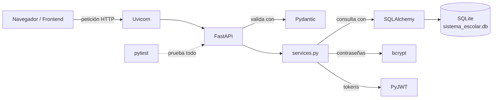

# 01 · Tecnologías que usa el backend

[← Volver al índice](README.md)

Cada sección responde cuatro preguntas: **qué es**, **para qué la usamos aquí**, **una analogía** y **un ejemplo de nuestro código**.

Antes, el panorama general. El backend es un programa en Python que se queda escuchando peticiones HTTP, es decir, mensajes que el navegador o el frontend envían por la red. Por cada petición:

1. **Uvicorn** recibe la petición de la red.
2. **FastAPI** decide qué función de Python la atiende.
3. **Pydantic** revisa que los datos recibidos sean válidos.
4. Nuestra lógica usa **SQLAlchemy** para leer o escribir en **SQLite**.
5. **bcrypt** y **PyJWT** protegen contraseñas y sesiones.
6. **pytest** comprueba automáticamente que todo lo anterior funcione.



---

## FastAPI

**Qué es.** Un *framework* web para Python. Un framework es un conjunto de herramientas ya hechas que define cómo se organiza tu código. FastAPI sirve para construir **APIs**: programas que reciben peticiones y responden con datos, normalmente en JSON, en lugar de páginas HTML.

**Para qué la usamos.**

- Definir las rutas o *endpoints* (`/usuarios/login`, `/cursos`…).
- Validar automáticamente los datos de entrada con Pydantic.
- Conectar cada ruta con lo que necesita (la base de datos, el usuario actual) mediante `Depends`.
- Generar la documentación interactiva en `/docs`.

**Analogía.** FastAPI es la **recepción de un hotel**. Cuando llega alguien, la recepcionista revisa su identificación (validación), ve a qué departamento va (ruta) y lo canaliza. Ella no limpia cuartos ni cocina: delega.

**Ejemplo de nuestro código:** `routers/usuarios.py → iniciar_sesion`

```python
router = APIRouter(prefix="/usuarios", tags=["Registro y sesión"])

@router.post("/login", response_model=schemas.SesionSalida)
def iniciar_sesion(credenciales: schemas.UsuarioLogin, db: Session = Depends(get_db)):
    return services.iniciarSesion(db, credenciales)
```

Cómo se lee:

- `@router.post("/login")`: esta función atiende peticiones **POST** a `/usuarios/login`. El prefijo `/usuarios` viene del `APIRouter`.
- `credenciales: schemas.UsuarioLogin`: FastAPI toma el JSON del cuerpo de la petición y lo valida con el esquema `UsuarioLogin`. Si no es válido, responde 422 **sin ejecutar la función**.
- `db: Session = Depends(get_db)`: *inyección de dependencias*. FastAPI llama a `get_db()` y nos pasa el resultado, que es una conexión a la base de datos. Nosotros no la abrimos ni la cerramos.
- `response_model=schemas.SesionSalida`: la respuesta se filtra con ese esquema, así que solo salen los campos declarados.

---

## Uvicorn

**Qué es.** Un **servidor ASGI**: el programa que abre un puerto de red (por defecto el 8000), recibe las conexiones HTTP y se las entrega a FastAPI. ASGI es el estándar de comunicación entre servidores y frameworks de Python.

**Para qué la usamos.** FastAPI por sí solo no escucha la red. Uvicorn sí, y lo arrancamos con:

```powershell
uvicorn main:app --reload
```

**Analogía.** Si FastAPI es la recepcionista, Uvicorn es **la puerta del hotel y el conmutador telefónico**: deja pasar a la gente y entrega las llamadas.

**Ejemplo de nuestro código.** Uvicorn no aparece en ningún `.py`. Solo busca la variable `app` en `main.py`:

```python
app = FastAPI(title="API SEPA", lifespan=lifespan)
```

---

## SQLAlchemy

**Qué es.** Un **ORM** (*Object-Relational Mapper*): una librería que traduce entre **clases de Python** y **tablas de una base de datos**. En lugar de escribir SQL a mano (`SELECT * FROM Usuario WHERE id = 1`), escribes Python (`db.get(models.Usuario, 1)`).

**Para qué la usamos.**

- Declarar las tablas como clases en `models.py`.
- Crear las tablas automáticamente (`Base.metadata.create_all`).
- Consultar, insertar y actualizar datos desde `services.py`.
- Manejar **transacciones**: grupos de cambios que se guardan todos juntos o no se guarda ninguno.

**Analogía.** SQLAlchemy es un **traductor**. Tú hablas Python, la base de datos habla SQL, y el traductor convierte lo que dices sin que aprendas el otro idioma.

**Ejemplo de nuestro código:** `models.py → Usuario` define la tabla:

```python
class Usuario(Base):
    __tablename__ = "Usuario"
    id = Column(Integer, primary_key=True, autoincrement=True)
    nombre = Column(String, nullable=False)
    correoInstitucional = Column(String, unique=True, nullable=False)
    ...
```

Y `services.py → registrarse` la usa:

```python
if db.query(models.Usuario).filter_by(correoInstitucional=datos.correoInstitucional).first():
    raise HTTPException(409, "El correo institucional ya está registrado")
```

Eso equivale a `SELECT * FROM Usuario WHERE correoInstitucional = '...' LIMIT 1`.

Piezas clave en `database.py`:

| Pieza | Qué es |
|-------|--------|
| `engine` | La conexión "de fábrica" con el archivo `sistema_escolar.db` |
| `SessionLocal` | Molde para crear **sesiones**: una sesión es una conversación con la base, donde se acumulan cambios hasta hacer `commit()` |
| `Base` | Clase madre de la que heredan todos los modelos |
| `get_db()` | Abre una sesión por cada petición y la cierra al terminar, aunque haya error |

---

## SQLite

**Qué es.** Un motor de base de datos **que vive en un solo archivo**. No hay que instalar ningún servidor de base de datos: Python ya trae soporte para SQLite.

**Para qué la usamos.** Toda la información se guarda en `backend/sistema_escolar.db`. Las pruebas usan otra base SQLite **en memoria**, que desaparece al terminar.

**Analogía.** Es una **libreta** que guardas en tu mochila, en vez de un archivero en otra oficina (como MySQL o PostgreSQL). Es práctica para un proyecto escolar; para muchos usuarios simultáneos se cambiaría por un servidor real.

**Ejemplo de nuestro código:** `database.py`

```python
DB_PATH = Path(__file__).resolve().parent / "sistema_escolar.db"
engine = create_engine(f"sqlite:///{DB_PATH}", connect_args={"check_same_thread": False})

@event.listens_for(engine, "connect")
def activar_llaves_foraneas(conexion, _):
    conexion.execute("PRAGMA foreign_keys=ON")  # SQLite las ignora si no se activa
```

- La ruta es **absoluta**, así que la base siempre queda en `backend/` sin importar desde dónde arranques.
- `check_same_thread=False` permite que varias peticiones (hilos) usen la conexión. SQLite lo prohíbe por defecto.
- Por defecto SQLite **no revisa** las llaves foráneas. Este `PRAGMA` las activa en cada conexión.

> El archivo `.db` está en `.gitignore`: cada integrante tiene su propia base local.

---

## Pydantic

**Qué es.** Una librería para **validar datos** usando clases con tipos. Declaras qué forma deben tener los datos (`nombre: str`, `edad: int`) y Pydantic revisa, convierte y, si algo está mal, genera errores detallados.

**Para qué la usamos.** Todos los esquemas de `schemas.py`:

- **Entrada**: `UsuarioCrear`, `UsuarioLogin`, `CursoCrear`… validan lo que manda el frontend.
- **Salida**: `UsuarioSalida`, `CursoPublico`… controlan qué campos se devuelven. Por ejemplo, nunca la contraseña.

**Analogía.** Pydantic es el **formulario con casillas obligatorias** de una oficina de gobierno. Si dejas algo vacío o pones letras donde van números, la ventanilla te lo regresa antes de que llegue al funcionario.

**Ejemplo de nuestro código:** `schemas.py → UsuarioCrear` y la validación de contraseña (RF-03):

```python
def _contrasena(v: str) -> str:  # RF-03
    if len(v) < 8:
        raise ValueError("La contraseña debe tener al menos 8 caracteres")
    ...

Contrasena = Annotated[str, AfterValidator(_contrasena)]

class UsuarioCrear(BaseModel):  # RF-01, RF-02, RF-03
    nombre: Nombre
    correoInstitucional: CorreoNormalizado
    contrasena: Contrasena
    confirmarContrasena: str
    codigo: CodigoEstudiante | None = None
    ...
    @model_validator(mode="after")
    def validar_formulario(self):
        if self.contrasena != self.confirmarContrasena:
            raise ValueError("La contraseña y su confirmación no coinciden")
        ...
```

Conceptos que aparecen en `schemas.py`:

| Concepto | Qué hace | Ejemplo |
|----------|----------|---------|
| `Annotated[str, ...]` | Un tipo `str` con reglas extra | `Texto`, `Nombre`, `Clave` |
| `StringConstraints` | Longitud mínima/máxima, quitar espacios, pasar a mayúsculas, patrón | `Clave` pasa `"icom"` a `"ICOM"` |
| `AfterValidator(f)` | Ejecuta `f` **después** de la validación básica | `_contrasena`, `_nombre` |
| `BeforeValidator(f)` | Ejecuta `f` **antes**; sirve para convertir | `_a_texto` acepta el código `123456789` como número y lo vuelve texto |
| `@model_validator(mode="after")` | Revisa varios campos a la vez | Que la contraseña y su confirmación coincidan |
| `@field_validator("campo")` | Revisa un solo campo con lógica propia | `DocenteCrear.correo_de_docente` |
| `Literal["a", "b"]` | Solo se aceptan esos valores exactos | `TipoEvaluacion`, `Dia` |
| `EmailStr` | Valida formato de correo (usa la librería `email-validator`) | `correoInstitucional` |
| `ConfigDict(from_attributes=True)` | Permite crear el esquema a partir de un objeto de SQLAlchemy | `UsuarioSalida`, `CursoPublico` |

---

## bcrypt

**Qué es.** Un algoritmo de **hash** para contraseñas. Un *hash* es una transformación de un solo sentido: de `"Secreto123"` se obtiene algo como `$2b$12$Kq...`, pero del hash **no se puede** obtener la contraseña original. bcrypt además es lento a propósito y agrega una **sal**: un valor aleatorio que hace que dos contraseñas iguales den hashes distintos.

**Para qué la usamos.** Para que la base de datos **nunca** guarde contraseñas legibles. Al iniciar sesión, se vuelve a calcular el hash y se compara.

**Analogía.** Es como una **licuadora**. De una fresa obtienes un licuado, pero del licuado no puedes reconstruir la fresa. Para saber si alguien trae "la misma fresa", licúas la suya y comparas los licuados.

**Ejemplo de nuestro código:** `security.py → hashear` y `security.py → verificar`

```python
def hashear(contrasena: str) -> str:
    return bcrypt.hashpw(contrasena.encode(), bcrypt.gensalt()).decode()

def verificar(contrasena: str, hash_guardado: str) -> bool:
    return bcrypt.checkpw(contrasena.encode(), hash_guardado.encode())
```

Más en [04-seguridad.md](04-seguridad.md#1-cómo-se-guardan-las-contraseñas-bcrypt).

---

## PyJWT

**Qué es.** Una librería para crear y leer **JWT** (*JSON Web Token*). Un JWT es un texto firmado digitalmente que contiene datos, por ejemplo "este es el usuario 5 y su sesión vence a las 18:00". Cualquiera puede leer su contenido, pero **nadie puede modificarlo** sin conocer la clave secreta, porque la firma dejaría de coincidir.

**Para qué la usamos.** Para las sesiones. Al iniciar sesión, el servidor entrega un token. En cada petición siguiente, el frontend lo manda de vuelta y así el servidor sabe quién es.

**Analogía.** Es la **pulsera de un concierto**. En la entrada te revisan el boleto una sola vez y te ponen una pulsera difícil de falsificar. Después solo enseñas la pulsera, y tiene fecha de caducidad.

**Ejemplo de nuestro código:** `security.py → crear_token`

```python
def crear_token(usuario_id: int) -> str:
    exp = datetime.now(timezone.utc) + timedelta(hours=HORAS_SESION)
    return jwt.encode({"sub": str(usuario_id), "exp": exp, "jti": uuid.uuid4().hex}, SECRET_KEY, ALGORITMO)
```

Más en [04-seguridad.md](04-seguridad.md#2-qué-es-un-jwt-y-cómo-lo-usamos).

---

## pytest

**Qué es.** Una herramienta para escribir y ejecutar **pruebas automáticas**: funciones que llaman a tu código y comprueban, con `assert`, que el resultado sea el esperado.

**Para qué la usamos.** Para comprobar los requerimientos (RF-01, RF-02…) sin hacerlo a mano en `/docs`. Hay unas 87 pruebas en `test_registro_login.py` y `test_gestion_academica.py`.

**Analogía.** Es una **lista de verificación de piloto** antes de despegar. Cada punto se revisa siempre, de la misma forma, y si uno falla te enteras antes de volar.

**Ejemplo de nuestro código:** `test_registro_login.py → test_rf06_logout_invalida_la_sesion`

```python
def test_rf06_logout_invalida_la_sesion(client):
    t = alta_alumno(client)
    assert client.post("/usuarios/logout", headers=auth(t)).status_code == 200
    assert client.get("/usuarios/yo", headers=auth(t)).status_code == 401
```

Más en [07-pruebas.md](07-pruebas.md).

---

## Librerías de apoyo

| Librería | Para qué |
|----------|----------|
| `email-validator` | Pydantic la usa por dentro para validar `EmailStr` |
| `httpx` | El `TestClient` de las pruebas la usa para simular peticiones HTTP. **No está en `requirements.txt` (Por confirmar)** |
| `starlette` | FastAPI está construido sobre ella; se instala sola con FastAPI |

[← Volver al índice](README.md) · [Siguiente: Arquitectura →](02-arquitectura.md)
