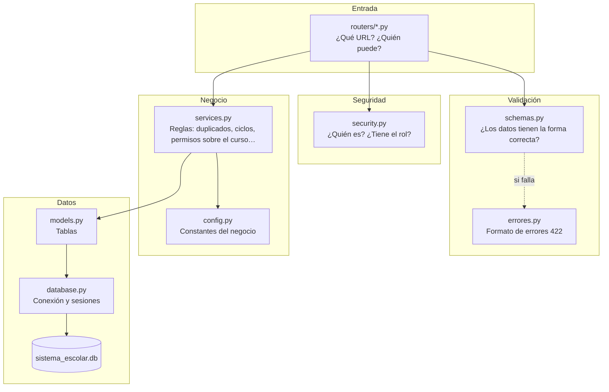
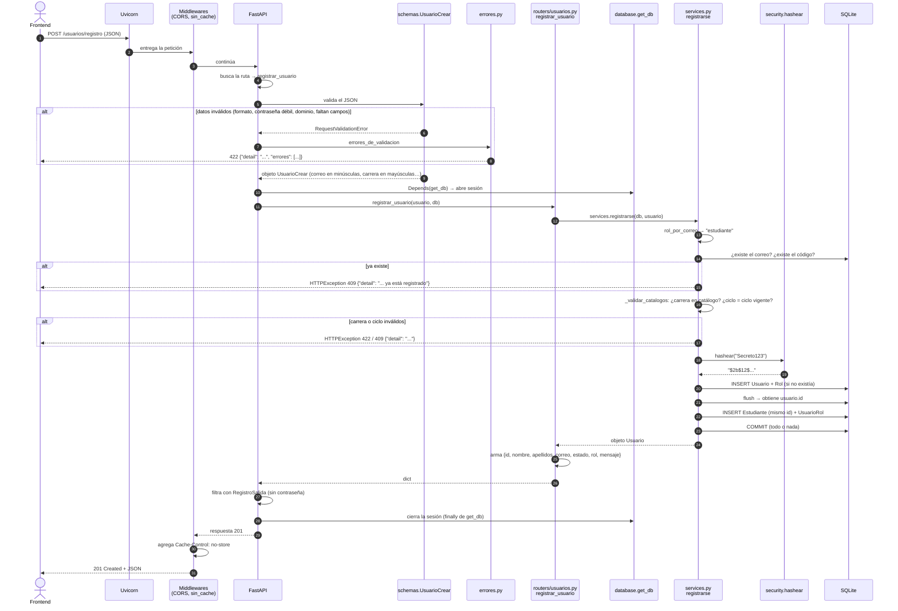

# 02 · Arquitectura del backend

[← Volver al índice](README.md)

## Estructura de carpetas

```
SEPA/
└── proyecto-escolar/
    ├── frontend/                  (fuera del alcance de esta documentación)
    └── backend/
        ├── main.py                ← punto de arranque: crea la app y junta los routers
        ├── config.py              ← reglas fijas del negocio (dominios, umbral 60, días…)
        ├── database.py            ← conexión a SQLite y sesiones
        ├── models.py              ← tablas de la base de datos (SQLAlchemy)
        ├── schemas.py             ← forma y validación de los datos que entran y salen (Pydantic)
        ├── services.py            ← lógica de negocio (todas las reglas y consultas)
        ├── security.py            ← contraseñas, tokens y control de roles
        ├── errores.py             ← traduce los errores de validación al español (RF-04)
        ├── planes.json            ← mallas curriculares de ICOM e INFO (datos iniciales)
        ├── crear_admin.py         ← script para crear el primer administrador
        ├── requirements.txt       ← librerías a instalar
        ├── routers/
        │   ├── __init__.py        ← vacío; convierte la carpeta en paquete de Python
        │   ├── usuarios.py        ← /usuarios/...  registro, login, logout, perfil
        │   ├── catalogos.py       ← /catalogos/... listas públicas (carreras, ciclos…)
        │   ├── cursos.py          ← /cursos y /inscripcion
        │   ├── docentes.py        ← /docente/...   controles del docente sobre sus cursos
        │   └── admin.py           ← /admin/...     gestión de usuarios, catálogos y cursos
        ├── conftest.py            ← configuración de pytest (fixture "client")
        ├── helpers.py             ← datos y funciones de apoyo para las pruebas
        ├── test_registro_login.py
        ├── test_gestion_academica.py
        ├── sistema_escolar.db     ← la base de datos (se crea sola; no se sube a Git)
        ├── uploads/               ← archivos subidos (RNF-8; se crea sola; no se sube a Git)
        └── venv/                  ← entorno virtual (no se sube a Git)
```

## Qué hace cada archivo

| Archivo | Responsabilidad | Funciones o clases importantes |
|---------|-----------------|--------------------------------|
| `main.py` | Crea la aplicación FastAPI, crea las tablas, siembra catálogos al arrancar, configura CORS y caché, registra los routers | `app`, `lifespan`, `sin_cache` |
| `config.py` | Constantes y reglas que no dependen de la base de datos | `DOMINIOS_ROL`, `UMBRAL_APROBATORIO`, `rol_por_correo`, `fechas_ciclo` |
| `database.py` | Conexión con `sistema_escolar.db` y entrega de sesiones | `engine`, `SessionLocal`, `Base`, `get_db` |
| `models.py` | Una clase por tabla | `Usuario`, `Estudiante`, `Docente`, `Curso`, `Matricula`… |
| `schemas.py` | Esquemas de entrada (validan) y de salida (filtran) | `UsuarioCrear`, `UsuarioLogin`, `CursoCrear`, `CursoPublico`… |
| `services.py` | Todas las reglas de negocio. Su docstring lo dice: *"Los routers solo reciben, delegan aquí y responden."* | `registrarse`, `iniciarSesion`, `crearCurso`, `inscribirseCurso`… |
| `security.py` | Hash de contraseñas, creación y verificación de tokens, dependencias de rol | `hashear`, `crear_token`, `usuario_actual`, `requiere_admin`, `requiere_docente` |
| `errores.py` | Da formato en español a los errores 422 de validación | `errores_de_validacion`, `_traducir` |
| `routers/*.py` | Declaran las rutas HTTP y delegan en `services.py` | Ver [05-endpoints.md](05-endpoints.md) |
| `planes.json` | Materias de las mallas ICOM (plan 2021-B, 43 materias) e INFO (rev. 2023, 40 materias) | Lo lee `services.py → _sembrar_planes` |
| `crear_admin.py` | Script de consola para el primer administrador | `main` |

## Cómo se dividen las responsabilidades (capas)

El backend está dividido en **capas**. Cada capa tiene un solo trabajo y solo habla con la capa de abajo.



| Capa | Pregunta que responde | Qué **no** hace |
|------|----------------------|-----------------|
| **Router** | ¿Qué función atiende esta URL? ¿Qué esquema de entrada y salida usa? ¿Qué dependencia de seguridad exige? | No tiene reglas de negocio (salvo algunas consultas de una línea, ver nota) |
| **Schema** | ¿El JSON tiene los campos, tipos y formatos correctos? | No consulta la base. Por ejemplo, no sabe si un correo ya existe |
| **Security** | ¿El token es válido? ¿El usuario existe y está activo? ¿Es docente o administrador? | No decide si un docente es **dueño** de un curso (eso es negocio) |
| **Service** | ¿Se puede hacer esto según las reglas? Si sí, lo hace en la base | No sabe nada de HTTP salvo lanzar `HTTPException` |
| **Model / Database** | ¿Cómo se guardan los datos? | No valida reglas |

> **Nota:** unos cuantos endpoints consultan la base **directamente desde el router**, sin pasar por `services.py`: `routers/catalogos.py → carreras`, `routers/cursos.py → obtener_cursos` y `routers/admin.py → listar_todos_los_cursos`. Son consultas simples de una línea.

**¿Por qué separar así?**

- **Probar es más fácil:** `services.py` se puede llamar sin servidor; `crear_admin.py` y `helpers.py` lo hacen.
- **Cambiar es más seguro:** si cambia una regla, solo se toca `services.py`. Si cambia una URL, solo el router.
- **Reutilizar:** `crear_admin.py` usa el mismo `services.crear_administrador` que el endpoint `POST /admin/administradores`.

### Cómo se avisa un error desde cualquier capa

| Dónde ocurre | Cómo se genera | Qué recibe el cliente |
|--------------|----------------|-----------------------|
| Schema (Pydantic) | Pydantic lanza `RequestValidationError` | 422 con lista `errores[]` (formato de `errores.py`) |
| Security | `raise HTTPException(401 / 403, "...")` | `{"detail": "..."}` |
| Service | `raise HTTPException(404 / 409 / 422 / 500, "...")` | `{"detail": "..."}` |

Detalle completo en [06-errores.md](06-errores.md).

## `main.py`: el punto de arranque

Esto pasa, en orden, cuando Uvicorn carga `main.py`:

```python
models.Base.metadata.create_all(bind=engine)          # 1. crea las tablas que falten

@asynccontextmanager
async def lifespan(_):                                # 2. corre una vez, al arrancar
    with SessionLocal() as db:
        services.sembrar_catalogos(db)
    yield

app = FastAPI(title="API SEPA", lifespan=lifespan)
app.add_exception_handler(RequestValidationError, errores_de_validacion)  # 3. errores 422 en español

app.add_middleware(CORSMiddleware,                    # 4. CORS
    allow_origins=["http://localhost:5500", "http://127.0.0.1:5500"], ...)

@app.middleware("http")
async def sin_cache(request, call_next):              # 5. RF-06
    respuesta = await call_next(request)
    respuesta.headers["Cache-Control"] = "no-store"
    return respuesta

app.include_router(usuarios.router)                   # 6. registra las rutas
...
```

1. **`create_all`** crea en `sistema_escolar.db` cada tabla de `models.py` que todavía no exista. **No modifica** tablas existentes: si agregas una columna a un modelo, la tabla vieja no la tendrá. Hay que borrar el `.db` (perdiendo los datos) o migrarla a mano.
2. **`lifespan`** es código que corre **una vez al arrancar** el servidor. Llama a `services.py → sembrar_catalogos`, que crea las carreras ICOM e INFO, las mallas curriculares de `planes.json` y el ciclo escolar en curso, **solo si esas tablas están vacías**.
3. **`add_exception_handler`** cambia el formato de los errores de validación (ver [06-errores.md](06-errores.md)).
4. **CORS** (*Cross-Origin Resource Sharing*) es una regla de los navegadores: una página servida desde un origen (por ejemplo `http://127.0.0.1:5500`) no puede llamar a una API en otro origen (`http://127.0.0.1:8000`) a menos que la API lo autorice. Aquí se autoriza el puerto **5500**, el que usa la extensión *Live Server* de VS Code. Si sirven el frontend en otro puerto, hay que agregarlo a `allow_origins`.
5. **Middleware `sin_cache`**: un *middleware* es código que se ejecuta en **todas** las peticiones, antes y después del endpoint. Este agrega `Cache-Control: no-store` a cada respuesta para que el navegador no guarde copias. Así, tras cerrar sesión, el botón "atrás" no muestra datos viejos (RF-06).
6. **`include_router`** agrega a la aplicación las rutas de cada archivo de `routers/`: `usuarios`, `catalogos`, `cursos`, `docentes` y `admin`.

## Recorrido completo de una petición: `POST /usuarios/registro`

Seguimos el caso de una estudiante, Ana, que se registra. El JSON que envía el frontend es el de `helpers.py → ALUMNO`:

```json
{
  "codigo": "123456789", "nombre": "Ana", "apellidos": "López",
  "carrera": "INFO", "ciclo": "2026-B",
  "correoInstitucional": "ana@alumnos.udg.mx",
  "contrasena": "Secreto123", "confirmarContrasena": "Secreto123"
}
```



### Paso a paso en el código

1. **Uvicorn** recibe los bytes de la red y se los pasa a la app de FastAPI.
2. **Middlewares.** `CORSMiddleware` revisa el origen. `sin_cache` deja pasar la petición y, al final, marca la respuesta.
3. **Ruteo.** FastAPI encuentra `@router.post("/registro")` dentro del router con prefijo `/usuarios` (`routers/usuarios.py → registrar_usuario`).
4. **Validación con Pydantic** (`schemas.py → UsuarioCrear`):
   - `nombre` y `apellidos`: solo letras, espacios, apóstrofes y guiones; de 1 a 100 caracteres (`_nombre`, `Texto`).
   - `correoInstitucional`: formato de correo válido y convertido a minúsculas (`CorreoNormalizado`).
   - `contrasena`: entre 8 y 72 caracteres, con minúscula, mayúscula y número (`_contrasena`, RF-03).
   - `codigo`: exactamente 9 dígitos; también se acepta como número (`CodigoEstudiante`).
   - `carrera`: se convierte a mayúsculas (`Clave`).
   - `validar_formulario` revisa que las contraseñas coincidan, que el dominio del correo sea institucional y que vengan los campos que exige el rol.
   - Si algo falla, **la función del router nunca se ejecuta**: `errores.py` responde 422.
5. **Dependencias.** `Depends(get_db)` abre una sesión de base de datos (`database.py → get_db`).
6. **Router.** Llama a `services.registrarse(db, usuario)`.
7. **Servicio** (`services.py → registrarse`):
   1. Obtiene el rol a partir del dominio del correo con `config.py → rol_por_correo`: `alumnos.udg.mx` → `estudiante`.
   2. Busca si el correo ya existe (409) y si el código de estudiante ya existe (409).
   3. `_validar_catalogos`: la carrera debe estar en la tabla `Carrera` (si no, 422). Debe haber un ciclo vigente (si no, 409) y el ciclo enviado debe ser ese (si no, 422).
   4. Define el estado: el estudiante queda `activo`. Un docente quedaría `pendiente` si `DOCENTE_REQUIERE_APROBACION` está activo.
   5. Busca el `Rol` "estudiante" o lo crea si es la primera vez.
   6. Crea el `Usuario` con la contraseña **hasheada** (`security.py → hashear`).
   7. **Transacción:** `add_all` → `flush` (envía los INSERT sin confirmar, para conocer el `id` generado) → crea `Estudiante` con ese mismo `id` → inserta en `UsuarioRol` → `commit`. Si algo choca (`IntegrityError`), hace `rollback` y responde 409. Así nunca queda un Usuario sin su perfil.
8. **Respuesta.** El router arma un diccionario con los datos públicos más `estado`, `rol` y `mensaje`. FastAPI lo filtra con `RegistroSalida`, así que, aunque se colara un campo extra, **la contraseña nunca sale**.
9. **Cierre.** El `finally` de `get_db` cierra la sesión. `sin_cache` agrega el encabezado y el cliente recibe:

```http
HTTP/1.1 201 Created
Cache-Control: no-store
Content-Type: application/json

{
  "id": 1,
  "nombre": "Ana",
  "apellidos": "López",
  "correoInstitucional": "ana@alumnos.udg.mx",
  "estado": "activo",
  "rol": "estudiante",
  "mensaje": "Cuenta creada correctamente"
}
```

[← Tecnologías](01-tecnologias.md) · [Volver al índice](README.md) · [Siguiente: Base de datos →](03-base-de-datos.md)
