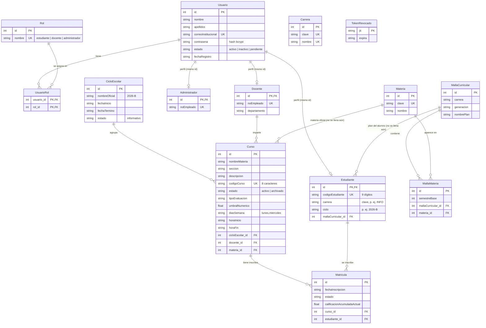
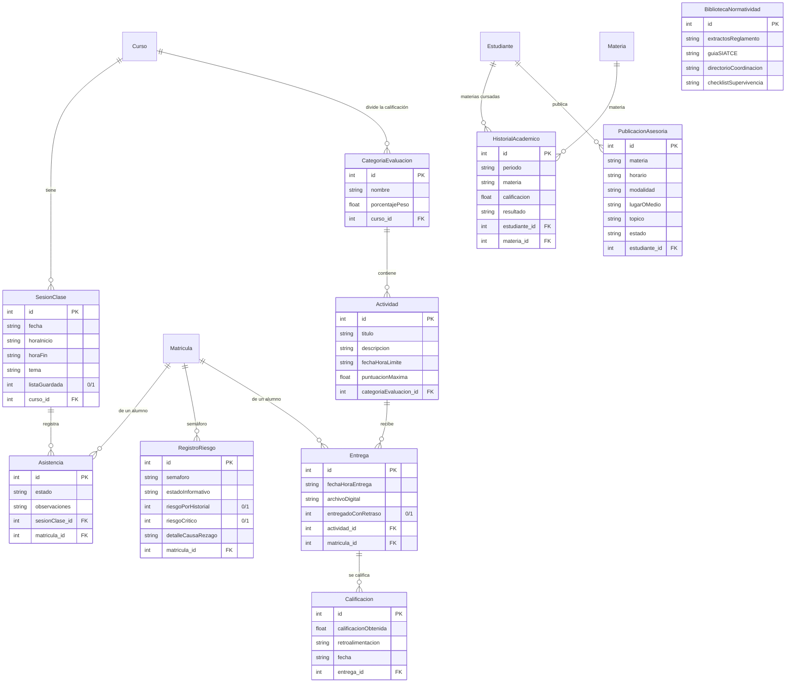
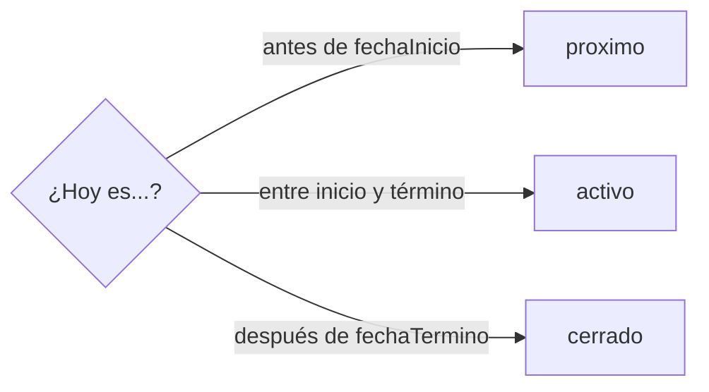
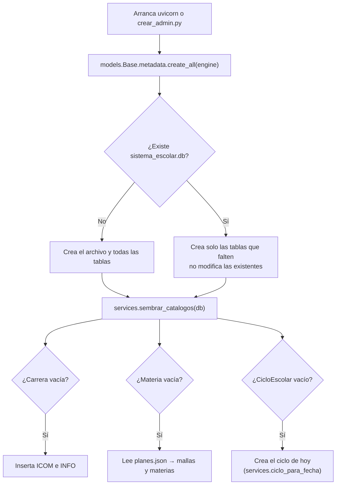

# 03 · Base de datos

[← Volver al índice](README.md)

Todo se define en **`models.py`**. Cada clase que hereda de `Base` es una **tabla**, y cada `Column(...)` es una **columna**. La base es un archivo SQLite: `backend/sistema_escolar.db`.

## Conceptos rápidos

| Término | Significado | En el código |
|---------|-------------|--------------|
| **Llave primaria (PK)** | Columna que identifica de forma única cada fila | `primary_key=True` |
| **Llave foránea (FK)** | Columna que guarda el `id` de una fila de **otra** tabla; así se relacionan | `ForeignKey("Usuario.id")` |
| **Única (UK)** | No puede haber dos filas con el mismo valor | `unique=True` o `UniqueConstraint(...)` |
| **Obligatoria** | No puede quedar vacía (NULL) | `nullable=False` |
| **autoincrement** | La base asigna el número 1, 2, 3… sola | `autoincrement=True` |

### Tipos de datos que usamos

| SQLAlchemy | Qué guarda | Nota |
|------------|------------|------|
| `Integer` | Números enteros | También se usa como **booleano** (0/1) en `listaGuardada`, `entregadoConRetraso`, `riesgoPorHistorial` y `riesgoCritico` |
| `String` | Texto | **Las fechas y horas se guardan como texto**: fechas `"2026-07-16"`, fecha y hora `"2026-10-25T14:03:00"`, horas `"08:00"` |
| `Float` | Números con decimales | Calificaciones, porcentajes, umbral |

> **Ojo:** en `models.py` no se usa `relationship()` de SQLAlchemy, solo columnas `ForeignKey`. Por eso no existe `usuario.estudiante` ni `curso.matriculas`: las uniones entre tablas se escriben a mano con `join` en `services.py`. Ejemplos: `_roles_de` y `alumnos_de_curso`.

## Qué tablas se usan hoy

`models.py` declara **22 tablas**, pero los endpoints actuales solo usan una parte. Las demás están **modeladas para módulos futuros** (asistencia, evaluaciones, riesgo, asesorías…) y hoy ningún endpoint las lee ni las escribe.

| Estado | Tablas |
|--------|--------|
| **En uso** por endpoints o sembrado | `Usuario`, `Rol`, `UsuarioRol`, `Estudiante`, `Docente`, `Administrador`, `Carrera`, `CicloEscolar`, `Curso`, `Matricula`, `TokenRevocado`, `MallaCurricular`, `Materia`, `MallaMateria` (las 3 últimas solo al sembrar) |
| **Sin uso todavía** | `HistorialAcademico`, `PublicacionAsesoria`, `BibliotecaNormatividad`, `SesionClase`, `Asistencia`, `RegistroRiesgo`, `CategoriaEvaluacion`, `Actividad`, `Entrega`, `Calificacion` |

---

## Diagrama entidad-relación: tablas en uso

## Diagrama entidad-relación: tablas para módulos futuros

> `BibliotecaNormatividad` no tiene relación con ninguna otra tabla.

---

## Detalle de cada tabla en uso

En la columna "Obligatorio", "No" significa que el campo puede quedar vacío (NULL).

### `Usuario`: los datos comunes a todas las personas

| Campo | Tipo | Obligatorio | Notas |
|-------|------|-------------|-------|
| `id` | Integer | PK | Autoincremental |
| `nombre` | String | Sí | |
| `apellidos` | String | Sí | |
| `correoInstitucional` | String | Sí, **único** | Se guarda en minúsculas (`schemas.py → CorreoNormalizado`) |
| `contrasena` | String | Sí | **Hash bcrypt**, nunca la contraseña real |
| `estado` | String | Sí | `activo`, `inactivo` o `pendiente` (docente esperando aprobación) |
| `fechaRegistro` | String | Sí | Fecha y hora local, p. ej. `2026-10-25T14:03:00` (`services.py → _ahora`) |

### `Rol` y `UsuarioRol`: roles de cada usuario

`Rol` guarda los nombres de rol: `estudiante`, `docente` y `administrador`. Cada uno se crea **la primera vez que se necesita**, dentro de `registrarse` o `_crear_personal`.

`UsuarioRol` es una **tabla de asociación muchos a muchos**: una tabla intermedia que solo guarda pares (`usuario_id`, `rol_id`), de modo que un usuario podría tener varios roles. Está declarada con `Table(...)`, no como clase. La llave primaria es la pareja completa, así que no se puede repetir el mismo rol para el mismo usuario.

Los roles de esta tabla se usan para decidir a qué **panel** se manda al usuario (RF-90, `services.py → _panel_de`). Los **permisos** se revisan de otra forma (ver [04-seguridad.md](04-seguridad.md#4-cómo-se-verifica-el-rol)).

### `Estudiante`, `Docente` y `Administrador`: perfiles

Estas tablas usan el patrón **"perfil con el mismo id"**: su `id` es a la vez llave primaria y llave foránea hacia `Usuario.id`. Si Ana es el usuario 1, su fila en `Estudiante` también tiene `id = 1`. Así, `Usuario` guarda lo común y cada perfil guarda lo propio.

| Tabla | Campo | Tipo | Obligatorio | Notas |
|-------|-------|------|-------------|-------|
| `Estudiante` | `id` | Integer | PK, FK → Usuario | |
| | `codigoEstudiante` | String | Sí, único | 9 dígitos; es su **código de login** |
| | `carrera` | String | No | Clave de carrera (`INFO`). **No es FK** a `Carrera`; se valida contra el catálogo al registrarse |
| | `ciclo` | String | No | Ciclo en el que se registró (`2026-B`). **No es FK** a `CicloEscolar` |
| | `mallaCurricular_id` | Integer | No, FK | **Hoy no se llena** al registrarse |
| `Docente` | `id` | Integer | PK, FK → Usuario | |
| | `noEmpleado` | String | Sí, único | Se guarda en mayúsculas; es su **código de login** |
| | `departamento` | String | No | |
| `Administrador` | `id` | Integer | PK, FK → Usuario | |
| | `noEmpleado` | String | Sí, único | Es su **código de login** |

### `Carrera`: catálogo de carreras (RF-02)

| Campo | Tipo | Obligatorio | Notas |
|-------|------|-------------|-------|
| `id` | Integer | PK | |
| `clave` | String | Sí, único | Mayúsculas, de 2 a 10 caracteres alfanuméricos |
| `nombre` | String | Sí, único | |

Valores iniciales (`config.py → CARRERAS_INICIALES`): `ICOM` (Ingeniería en Computación) e `INFO` (Ingeniería Informática).

### `CicloEscolar`: ciclos escolares (RF-08)

| Campo | Tipo | Obligatorio | Notas |
|-------|------|-------------|-------|
| `id` | Integer | PK | |
| `nombreOficial` | String | Sí | `AAAA-A` o `AAAA-B`. **No tiene `unique` en la base**; los duplicados se evitan en `services.py → crearCiclo` |
| `fechaInicio` | String | Sí | Del calendario oficial |
| `fechaTermino` | String | Sí | Del calendario oficial |
| `estado` | String | Sí | **Solo informativo** (ver abajo) |

Calendario oficial (`config.py → CALENDARIO_CICLOS`):

| Ciclo | Inicio | Término |
|-------|--------|---------|
| `AAAA-A` | 16 de enero | 15 de julio |
| `AAAA-B` | 16 de julio | 16 de diciembre |

**El estado real del ciclo se calcula a partir de las fechas**, no del valor guardado (`services.py → estado_ciclo`):

El ciclo **vigente** (`services.py → ciclo_vigente`) es el que está `activo`. Entre dos ciclos (del 17 de diciembre al 15 de enero) es el `proximo` más cercano.

### `Curso`: cursos que crea un docente (RF-09 a RF-18)

| Campo | Tipo | Obligatorio | Notas |
|-------|------|-------------|-------|
| `id` | Integer | PK | |
| `nombreMateria` | String | Sí | |
| `seccion` | String | Sí | En mayúsculas (`D01`) |
| `descripcion` | String | No (en la base) | La API sí la exige al crear (RF-12) |
| `codigoCurso` | String | Sí, único | 8 caracteres hexadecimales en mayúsculas, generados con `uuid4` (RF-14, `services.py → generarCodigoUnico`) |
| `estado` | String | Sí | `activo` o `archivado` (RF-10) |
| `tipoEvaluacion` | String | Sí | `numerica` o `aprobado_no_aprobado` (RF-17) |
| `umbralNumerico` | Float | Sí | `60.0` si es numérica, `0.0` si es aprobado/no aprobado. **Lo fija el servidor** (RF-18) |
| `diasSemana` | String | Sí | Días separados por coma y en orden de la semana: `"lunes,miercoles"`. En la API viaja como lista |
| `horaInicio` / `horaFin` | String | Sí | `"HH:MM"` |
| `cicloEscolar_id` | Integer | FK → CicloEscolar | |
| `docente_id` | Integer | FK → Docente | El docente dueño del curso (RF-95) |
| `materia_id` | Integer | FK → Materia | **Hoy no se llena** al crear cursos |

### `Matricula`: inscripción de un estudiante en un curso (RF-15, RF-16)

| Campo | Tipo | Obligatorio | Notas |
|-------|------|-------------|-------|
| `id` | Integer | PK | |
| `fechaInscripcion` | String | Sí | Fecha y hora local |
| `estado` | String | Sí | Hoy siempre `activo` |
| `calificacionAcumuladaActual` | Float | No | Hoy siempre vacía |
| `curso_id` | Integer | FK → Curso | |
| `estudiante_id` | Integer | FK → Estudiante | |

Tiene `UniqueConstraint("curso_id", "estudiante_id")`: un estudiante **no puede inscribirse dos veces** al mismo curso, aunque haga doble clic.

### `MallaCurricular`, `Materia` y `MallaMateria`: planes de estudio

Se llenan **una sola vez** desde `planes.json` (`services.py → _sembrar_planes`). Hoy ningún endpoint los consulta.

- `MallaCurricular`: un plan por carrera: `ICOM` (generación 2021-B) e `INFO` (generación 2023).
- `Materia`: cada materia, con su `clave` única (p. ej. `I5288` Fundamentos de la Programación). Una materia que comparten ICOM e INFO se crea una sola vez.
- `MallaMateria`: tabla intermedia que indica en qué semestre (`semestreBase`) va cada materia en cada malla. No se puede repetir la misma pareja malla–materia.

### `TokenRevocado`: sesiones cerradas (RF-06, RF-91)

| Campo | Tipo | Notas |
|-------|------|-------|
| `jti` | String, PK | Identificador único del token cerrado |
| `expira` | String | Cuándo habría vencido el token (ISO, en UTC) |

Explicación completa en [04-seguridad.md](04-seguridad.md#5-cómo-funciona-el-logout).

---

## Cómo se crea la base

No hay scripts SQL: **SQLAlchemy la crea a partir de `models.py`**.

1. `create_all` se ejecuta en `main.py`, al importar el archivo, y en `crear_admin.py → main`.
2. `sembrar_catalogos` se ejecuta en el `lifespan` de `main.py` y en `crear_admin.py`. Es **idempotente**: llamarla varias veces da el mismo resultado que llamarla una vez, porque solo inserta en tablas vacías. La prueba `test_sembrar_crea_ciclo_en_curso` lo comprueba.
3. El ciclo inicial se calcula con `services.py → ciclo_para_fecha(hoy())`. Si hoy es 26 de octubre de 2026, crea `2026-B` (del 16/07/2026 al 16/12/2026).

**Para empezar de cero:** detén el servidor, borra `backend/sistema_escolar.db` y vuelve a ejecutar `python crear_admin.py`. Se pierden todos los datos.

> **Cambios en `models.py`:** `create_all` **no agrega columnas nuevas** a tablas que ya existen. Si alguien modifica un modelo, los demás deben borrar su `.db`. El proyecto no usa una herramienta de migraciones como Alembic.

## `crear_admin.py`

**Problema que resuelve:** para crear un administrador por la API (`POST /admin/administradores`) ya hay que ser administrador. El primero se crea con este script.

**Qué hace** (`crear_admin.py → main`):

1. `create_all`: crea la base y las tablas si no existen.
2. Pide por consola nombre, apellidos, correo, número de empleado y contraseña. La contraseña se lee con `getpass`, que no la muestra en pantalla.
3. Valida los datos con el **mismo esquema** que la API: `schemas.AdminCrear`. Si algo es inválido, imprime los errores y termina sin crear nada.
4. `services.sembrar_catalogos(db)`: datos iniciales.
5. `services.crear_administrador(db, datos)`: crea `Usuario` (estado `activo`), su perfil `Administrador`, el `Rol` "administrador" y el vínculo en `UsuarioRol`, todo en una transacción.
6. Si el correo o el número de empleado ya existen, imprime `No se pudo crear: ...` y termina.
7. Al final indica con qué código iniciar sesión: el número de empleado, en mayúsculas.

> **Por confirmar:** `AdminCrear` **no exige un dominio institucional** en el correo (las pruebas usan `admin@escuela.mx`), a diferencia de `DocenteCrear`. No sabemos si es intencional.

[← Arquitectura](02-arquitectura.md) · [Volver al índice](README.md) · [Siguiente: Seguridad →](04-seguridad.md)
