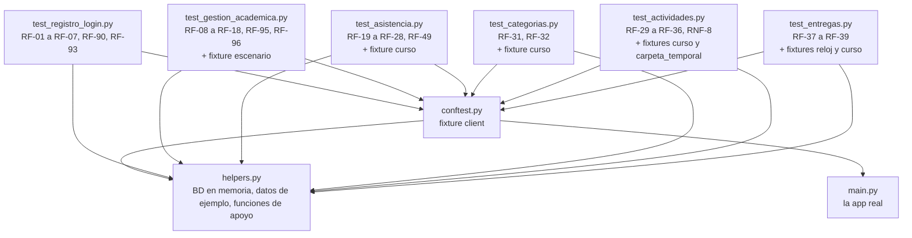

# 07 · Pruebas automáticas

[← Volver al índice](README.md)

## Qué es pytest y por qué lo usamos

Una **prueba automática** es una función que usa tu programa como lo haría un usuario y **comprueba** que el resultado sea el esperado. **pytest** es la herramienta que encuentra esas funciones, las ejecuta y te dice cuáles pasaron y cuáles fallaron.

Sin pruebas, para comprobar que "un estudiante no puede inscribirse dos veces" tendrías que abrir `/docs`, registrar un alumno, iniciar sesión, crear un docente, crear un curso, inscribirte dos veces… **cada vez que cambies algo**. Con pruebas, `pytest` revisa los ~87 casos en unos segundos.

### Conceptos básicos

| Concepto | Qué es | Ejemplo |
|----------|--------|---------|
| **Archivo de prueba** | pytest busca archivos que se llamen `test_*.py` | `test_registro_login.py` |
| **Función de prueba** | Dentro, ejecuta las funciones que empiezan con `test_` | `def test_rf04_login_con_codigo_y_contrasena(client):` |
| **`assert`** | "Afirmo que esto es verdad". Si es falso, la prueba **falla** | `assert r.status_code == 201` |
| **Fixture** | Una función que **prepara algo** que las pruebas necesitan. Se pide poniendo su nombre como parámetro | `client`, `escenario` |
| **`conftest.py`** | Archivo especial donde pytest busca fixtures compartidas; no hace falta importarlo | `conftest.py` |
| **`monkeypatch`** | Fixture de pytest que **reemplaza algo temporalmente** solo durante una prueba | Fijar la fecha de "hoy" |
| **`@pytest.mark.parametrize`** | Ejecuta la misma prueba con varios datos distintos | Cuatro contraseñas débiles → 4 casos |
| **`TestClient`** | Cliente de FastAPI que hace peticiones a la app **sin levantar un servidor** | `client.post("/usuarios/login", json=...)` |

### Cómo correrlas

Desde la carpeta `backend`, con el venv activado (recuerda: hace falta `pip install pytest httpx`):

```powershell
pytest -v                                   # todas, mostrando cada nombre
pytest test_registro_login.py -v            # un solo archivo
pytest -k rf15 -v                           # solo las que tengan "rf15" en el nombre
pytest -x                                   # se detiene en el primer fallo
```

Resultado típico:

```
test_registro_login.py::test_rf01_registro_exitoso_con_mensaje_y_sin_contrasena PASSED
test_registro_login.py::test_rf01_formatos_invalidos[cambio0] PASSED
...
========================= 87 passed in X.XXs =========================
```

`[cambio0]`, `[cambio1]`… son los distintos datos de una prueba con `parametrize`. El total de 87 sale de contar las funciones y sus casos parametrizados en el código; el tiempo (`X.XXs`) varía en cada computadora.

---

## Organización



### `conftest.py`: la fixture `client`

```python
@pytest.fixture()
def client(monkeypatch):
    monkeypatch.setattr(services, "hoy", lambda: date(2026, 10, 25))  # fecha fija: dentro de 2026-B
    models.Base.metadata.drop_all(engine)
    models.Base.metadata.create_all(engine)
    sembrar_base()
    app.dependency_overrides[get_db] = db_de_prueba
    yield TestClient(app)
    app.dependency_overrides.clear()
```

Esto se ejecuta **antes de cada prueba** que pida `client`:

1. **Fija la fecha.** `services.hoy()` siempre devolverá el 25 de octubre de 2026. Por eso `services.py` tiene esa función aparte con el comentario *"las pruebas lo reemplazan para fijar la fecha"*. Sin esto, las pruebas de ciclos (activo, próximo, cerrado) darían resultados distintos según el día en que se corran.
2. **Base de datos limpia.** Borra y vuelve a crear todas las tablas de la base **de prueba** (`helpers.engine`). Cada prueba empieza de cero y no depende de las demás.
3. **Datos mínimos.** `sembrar_base()` crea la carrera `INFO` y el ciclo `2026-B` (id 1).
4. **Cambia la base de datos de la app.** `dependency_overrides` le dice a FastAPI: "cuando un endpoint pida `get_db`, dale `db_de_prueba`". Así la app real usa la base en memoria y **no toca `sistema_escolar.db`**.
5. **`yield`** entrega el `TestClient` a la prueba. Lo que va después del `yield` se ejecuta **al terminar la prueba**: quita el reemplazo.

> Detalle: al importar `main.py`, se ejecuta `models.Base.metadata.create_all(bind=engine)` con el engine **real**. Si `sistema_escolar.db` no existía, se crea vacío. No se insertan datos, porque el `lifespan` (que siembra catálogos) **solo corre si el `TestClient` se usa con `with`**, y aquí no se usa.

### `helpers.py`: utilidades compartidas

**Base de datos en memoria:**

```python
engine = create_engine("sqlite://", connect_args={"check_same_thread": False}, poolclass=StaticPool)
```

- `"sqlite://"` sin nombre de archivo = base de datos **en memoria RAM**. Desaparece al terminar.
- `StaticPool` hace que todas las sesiones compartan **la misma conexión**. Sin esto, cada conexión vería su propia base en memoria vacía.

**Datos de ejemplo** (diccionarios listos para enviar como JSON):

| Nombre | Qué es |
|--------|--------|
| `ALUMNO` | Ana López, código `123456789`, `ana@alumnos.udg.mx`, carrera INFO, ciclo 2026-B, contraseña `Secreto123` |
| `ALUMNO_B` | Igual que `ALUMNO`, pero Beto, código `987654321` |
| `DOCENTE` | Luis Pérez, `luis@academicos.udg.mx`, `noEmpleado` `D-001`, contraseña `Docente123` |
| `CURSO` | "Bases de datos", sección D01, ciclo 1, numérica, lunes y miércoles de 08:00 a 10:00 |

**Funciones de apoyo:**

| Función | Qué hace |
|---------|----------|
| `auth(token)` | Devuelve el encabezado `{"Authorization": "Bearer <token>"}` |
| `login(client, codigo, contrasena)` | Llama a `POST /usuarios/login` y devuelve la respuesta |
| `token(client, codigo, contrasena)` | Hace login, comprueba que dé 200 y devuelve solo el `access_token` |
| `registrar(client, datos)` | Llama a `POST /usuarios/registro` |
| `crear_admin(client)` | Crea el administrador `A-001` / `Admin12345` **directamente con `services`**, igual que `crear_admin.py`, y devuelve su token |
| `alta_docente(client, ta, correo, no_empleado)` | Usa el token del admin (`ta`) para crear un docente con `POST /admin/docentes` y devuelve el token del docente |
| `alta_alumno(client, datos=ALUMNO)` | Registra un alumno y devuelve su token |

### `test_gestion_academica.py`: la fixture `escenario`

```python
@pytest.fixture()
def escenario(client):
    """Un administrador y dos docentes ya con sesión."""
    ta = crear_admin(client)
    t1 = alta_docente(client, ta, "d1@academicos.udg.mx", "D-1")
    t2 = alta_docente(client, ta, "d2@academicos.udg.mx", "D-2")
    return ta, t1, t2
```

Una fixture puede **depender de otra**: `escenario` pide `client`. Las pruebas que la usan reciben tres tokens: `ta` (admin), `t1` (docente 1) y `t2` (docente 2). En el mismo archivo, `_crear_curso(client, t, **cambios)` crea un curso con los datos de `CURSO` y comprueba que dé 201.

---

## Qué cubre cada archivo

### `test_registro_login.py`

29 funciones de prueba, 44 casos con los parametrizados. Docstring: *"Módulo: registro de sesión y login (RF-01 a RF-07, RF-89 a RF-93)"*.

| RF | Pruebas | Qué comprueban |
|----|---------|----------------|
| RF-01 | `test_rf01_registro_exitoso_con_mensaje_y_sin_contrasena`, `test_rf01_formatos_invalidos` (5 casos), `test_rf01_campos_obligatorios` (6), `test_rf01_el_codigo_se_acepta_como_numero` | Registro correcto con mensaje y sin contraseña en la respuesta; formatos inválidos y campos faltantes → 422; el código puede venir como número |
| RF-02 | `test_rf02_carrera_y_ciclo_deben_estar_en_el_catalogo`, `test_rf02_catalogos_publicos_y_administrables`, `test_rf02_codigo_y_correo_duplicados`, `test_rf02_el_ciclo_del_estudiante_es_el_que_esta_en_curso`, `test_rf02_entre_dos_ciclos_se_usa_el_siguiente` | Carrera y ciclo del catálogo; el admin agrega carreras; duplicados → 409; el ciclo debe ser el vigente; entre ciclos se usa el siguiente |
| RF-03 | `test_rf03_criterios_de_contrasena` (4), `test_rf03_la_confirmacion_debe_coincidir`, `test_rf03_no_se_crea_cuenta_si_hay_datos_invalidos` | Reglas de contraseña; confirmación; no se crea nada si hay errores |
| RF-04 | `test_rf04_login_con_codigo_y_contrasena`, `test_rf04_campos_vacios_dan_mensaje_especifico`, `test_rf04_datos_incorrectos_no_revelan_cual_fallo` | Login con código; mensajes en español por campo; mismo error si el código no existe o si la contraseña está mal |
| RF-05 | `test_rf05_acceso_protegido`, `test_rf05_token_alterado_no_sirve` | Sin token → 401/403; `/usuarios/yo` con token; un token modificado → 401 |
| RF-06 | `test_rf06_logout_invalida_la_sesion`, `test_rf06_las_respuestas_no_se_guardan_en_cache` | Tras logout el token no sirve y se puede volver a entrar; encabezado `Cache-Control: no-store` |
| RF-07 | `test_rf07_mensaje_de_recuperacion_manual`, `test_rf07_el_administrador_restablece_la_contrasena` | Mensaje de recuperación; el admin restablece la contraseña y valida RF-03 |
| Dominios y roles | `test_correos_fuera_de_dominio_se_rechazan` (4), `test_mayusculas_en_el_correo_no_crean_cuentas_distintas`, `test_faltan_datos_segun_el_rol`, `test_docente_por_dominio_y_aprobacion` | Solo dominios exactos; correo sin distinguir mayúsculas; docente sin `noEmpleado` → 422; docente queda pendiente hasta que el admin lo aprueba |
| RF-90 | `test_rf90_cada_rol_va_a_su_panel` | `panel` correcto para admin, docente y estudiante |
| RF-93 | `test_rf93_solo_el_administrador_gestiona_usuarios`, `test_rf93_admin_solo_crea_docentes_con_correo_academico`, `test_rf93_desactivar_cuentas` | Solo el admin lista usuarios; docentes con correo académico; desactivar cuentas y no poder desactivarse a sí mismo |

### `test_gestion_academica.py`

30 funciones de prueba, 43 casos. Docstring: *"Módulo de gestión académica (RF-08 a RF-18, RF-95, RF-96)"*.

| RF | Pruebas | Qué comprueban |
|----|---------|----------------|
| RF-08 | `test_rf08_solo_el_administrador_crea_ciclos`, `test_rf08_las_fechas_salen_del_calendario_oficial`, `test_rf08_estado_calculado_con_la_fecha`, `test_rf08_ciclos_invalidos` (3), `test_rf08_ciclo_duplicado`, `test_rf08_los_docentes_solo_seleccionan_del_catalogo` | Solo el admin crea ciclos; fechas oficiales; estado según la fecha; formatos inválidos; duplicado → 409 |
| RF-09 | `test_rf09_el_curso_exige_un_ciclo_existente_y_no_terminado`, `test_rf09_se_puede_preparar_un_curso_del_ciclo_proximo` | Sin ciclo → 422, inexistente → 404, cerrado → 409; ciclo próximo sí se permite |
| RF-10 / RF-11 | `test_rf10_rf11_archivar_y_filtrar`, `test_rf10_un_curso_archivado_se_puede_reactivar` | Archivar; por defecto se listan solo activos; reactivar |
| RF-12 | `test_rf12_campos_minimos_obligatorios` (3), `test_rf12_curso_duplicado_en_el_mismo_ciclo`, `test_rf12_solo_los_docentes_crean_cursos` | Materia, sección y descripción obligatorias; duplicado → 409; un alumno → 403 |
| RF-13 | `test_rf13_horario_base`, `test_rf13_horarios_invalidos` (5), `test_rf13_editar_horario` | Días ordenados; días o horas inválidos; editar respetando la hora guardada |
| RF-14 | `test_rf14_codigo_unico_alfanumerico`, `test_rf14_el_listado_general_no_expone_el_codigo` | Código de 8 caracteres, distinto por curso; `GET /cursos` no lo muestra |
| RF-15 | `test_rf15_autoinscripcion_por_codigo`, `test_rf15_el_codigo_no_distingue_mayusculas`, `test_rf15_un_curso_archivado_no_acepta_inscripciones` | Inscripción, duplicado 409, código inexistente 404, docente 403; minúsculas; archivado 409 |
| RF-16 | `test_rf16_listado_de_matricula` | El docente ve a sus alumnos con correo, estado y fecha |
| RF-17 | `test_rf17_solo_dos_tipos_de_evaluacion` | Otro tipo → 422; catálogo con las dos etiquetas |
| RF-18 | `test_rf18_el_umbral_es_60_y_no_se_puede_cambiar`, `test_rf18_aprobado_no_aprobado_no_usa_umbral` | Umbral 60 aunque el cliente mande otro; 0 en aprobado/no aprobado |
| RF-95 | `test_rf95_solo_el_docente_creador_controla_el_curso` | Otro docente, el admin y un alumno reciben 403 en los controles del curso |
| RF-96 | `test_rf96_el_alumno_no_puede_crear_ni_editar` | Un alumno no crea cursos ni ciclos |
| Otros | `test_el_administrador_puede_reasignar_un_curso`, `test_ciclo_para_fecha` (6), `test_sembrar_crea_ciclo_en_curso` | Reasignar docente; cálculo del ciclo por fecha (incluidos los bordes 15/16 de julio y 16/17 de diciembre); el sembrado no duplica datos |

> `test_ciclo_para_fecha` y `test_sembrar_crea_ciclo_en_curso` **no usan `client`**: prueban funciones de `services.py` directamente, sin HTTP. Es posible gracias a la separación en capas.

---

### `test_asistencia.py`

Docstring: *"Módulo de control de asistencia (RF-19 a RF-28, RF-49)"*. La fixture `curso` crea un curso de lunes y miércoles con Ana y Beto inscritos y fija la fecha en el **lunes 26 de octubre de 2026** (la fecha de `conftest.py` es domingo). `_clase(...)` genera y guarda la lista de una sesión en la fecha que se le indique.

| RF | Qué comprueban |
|----|----------------|
| RF-19 / RF-27 | Sesión de hoy con el horario del curso; tema opcional; solo en días de clase; sin duplicados; no en cursos archivados ni en ciclos que no han empezado |
| RF-22 | Los alumnos arrancan en `pendiente` y una lista sin guardar no cuenta |
| RF-20 / RF-23 | Guardar lista con observaciones; faltan alumnos, alumno ajeno, repetido o estado inválido → 422; un alumno de baja no aparece ni se acepta; un alumno inscrito después no es obligatorio |
| RF-25 | Editar la lista de una sesión pasada |
| RF-24 / RF-26 / RF-49 | Cuadrícula ordenada por fecha, estados por sesión, porcentaje, estatus normativo y semáforo; bordes de 85, 80 y 65 % |
| RF-95 | Otro docente, el admin y un alumno reciben 403 |

### `test_categorias.py`

Docstring: *"Módulo de categorías de evaluación (RF-31, RF-32)"*. La fixture `curso` crea un curso del docente `t1` y guarda la URL de sus categorías.

| RF | Qué comprueban |
|----|----------------|
| RF-31 | Crear, listar, editar y eliminar; peso 0, negativo o mayor que 100, nombre vacío o faltante → 422; nombre repetido → 409; no se elimina una categoría con actividades |
| RF-32 | Sin categorías o con suma distinta de 100 se guarda con advertencia; decimales que suman 100; superar 100 al crear o editar → 409 |
| RF-95 | Otro docente, el admin y un alumno reciben 403 |

### `test_actividades.py`

Docstring: *"Módulo de actividades (RF-29, RF-30, RF-33 a RF-36) y archivos adjuntos (RNF-8)"*. La fixture `carpeta_temporal` (automática) manda los archivos a una carpeta temporal de pytest en lugar de `uploads/` y fija `services.ahora()` en el 25/oct/2026 a las 12:00. La fixture `curso` crea un curso con las categorías Tareas (40 %) y Exámenes (60 %) y a Ana inscrita.

| Tema | Qué comprueban |
|------|----------------|
| CRUD | Crear, listar por fecha límite, ver, editar (incluso cambiar de categoría) y eliminar; datos inválidos → 422; fecha límite pasada → 422; categoría de otro curso → 404; curso archivado → 409; no se elimina con entregas |
| RF-34 | Las actividades de una categoría valen lo mismo sin importar su puntuación máxima; los valores suman 100 |
| RF-36 | Adjuntar, reemplazar (borra el anterior), quitar y descargar; descargan el docente y los alumnos inscritos; nadie más |
| RNF-8 | Tipos permitidos y no permitidos (415); 10 MB exactos sí, uno más no (413); archivo vacío (422) |
| RF-95 | Otro docente, el admin y un alumno reciben 403 |

### `test_entregas.py`

Docstring: *"Módulo de entregas del alumno (RF-37 a RF-39)"*. La fixture `reloj` reemplaza `services.ahora()` por una hora que cada prueba puede mover (`reloj["ahora"] = DESPUES`) y manda los archivos a una carpeta temporal. La fixture `curso` crea la actividad "Tarea 1" con límite el 1/nov/2026 a las 23:59 y a Ana y Beto inscritos.

| RF | Qué comprueban |
|----|----------------|
| Vista del alumno | Sus cursos (sin `codigoCurso`); sus actividades con `estadoEntrega` `pendiente` o `vencida` |
| RF-37 | La fecha y hora de entrega las pone el servidor; justo en la fecha límite es a tiempo; no se entrega dos veces |
| RF-38 | Cancelar (borra el archivo) y volver a subir antes de la fecha; no se cancela después ni si ya está calificada |
| RF-39 | Después de la fecha se acepta con `entregadoConRetraso` |
| Acceso | Solo alumnos inscritos y activos; curso archivado → 409; el docente ve las entregas de todos; solo el alumno y su docente descargan la entrega |

---

## Cómo agregar una prueba nueva

### Receta

1. **Elige el archivo:** si es de registro, sesión o usuarios, `test_registro_login.py`; si es de cursos, ciclos o inscripciones, `test_gestion_academica.py`.
2. **Nombra la función** `test_rfXX_descripcion_en_espanol`, siguiendo la convención del equipo. Así `pytest -k rfXX` la encuentra.
3. **Pide las fixtures** que necesites como parámetros: `client`, y en gestión académica también `escenario`.
4. **Prepara** los datos con los helpers (`alta_alumno`, `crear_admin`, `_crear_curso`…).
5. **Actúa:** haz la petición con `client.get/post/patch(...)`.
6. **Comprueba** con `assert` el código de estado y, si importa, el JSON.
7. **Córrela sola** primero: `pytest -k nombre_de_tu_prueba -v`.

### Ejemplo: cerrar sesión dos veces

Hoy no hay una prueba que verifique que un token ya cerrado tampoco sirve para un segundo logout. Agrégala en `test_registro_login.py`, junto a las de RF-06:

```python
def test_rf06_logout_dos_veces_da_401(client):
    # Preparar: un alumno registrado con sesión
    t = alta_alumno(client)

    # Actuar: cerrar sesión dos veces con el mismo token
    primera = client.post("/usuarios/logout", headers=auth(t))
    segunda = client.post("/usuarios/logout", headers=auth(t))

    # Comprobar
    assert primera.status_code == 200
    assert segunda.status_code == 401
    assert segunda.json()["detail"] == "La sesión ya no es válida; inicia sesión de nuevo"
```

`alta_alumno` y `auth` ya están importados al inicio del archivo. Ejecuta:

```powershell
pytest -k logout_dos_veces -v
```

### Ejemplo con parametrize y escenario

En `test_gestion_academica.py`: cualquier tipo de evaluación válido debe aceptarse al editar.

```python
@pytest.mark.parametrize("tipo, umbral", [("numerica", 60), ("aprobado_no_aprobado", 0)])
def test_rf18_editar_tipo_recalcula_umbral(client, escenario, tipo, umbral):
    _, t1, _ = escenario
    c = _crear_curso(client, t1)
    r = client.patch(f"/docente/cursos/{c['id']}", json={"tipoEvaluacion": tipo}, headers=auth(t1))
    assert r.status_code == 200
    assert r.json()["umbralNumerico"] == umbral
```

### Si necesitas otra fecha

Usa `monkeypatch` dentro de la prueba, como en `test_rf02_entre_dos_ciclos_se_usa_el_siguiente`:

```python
def test_algo_en_vacaciones(client, monkeypatch):
    monkeypatch.setattr(services, "hoy", lambda: date(2026, 12, 20))
    ...
```

### Buenas prácticas

- **Una idea por prueba.** Si falla, el nombre debe decir qué se rompió.
- **No dependas de otras pruebas.** Cada una empieza con la base limpia y prepara lo suyo.
- **Comprueba el código y el mensaje** cuando el mensaje sea parte del requerimiento (RF-04).
- **No uses `sistema_escolar.db`.** Usa siempre `client` o `helpers.Sesion`.

[← Errores](06-errores.md) · [Volver al índice](README.md) · [Siguiente: Glosario →](08-glosario.md)
