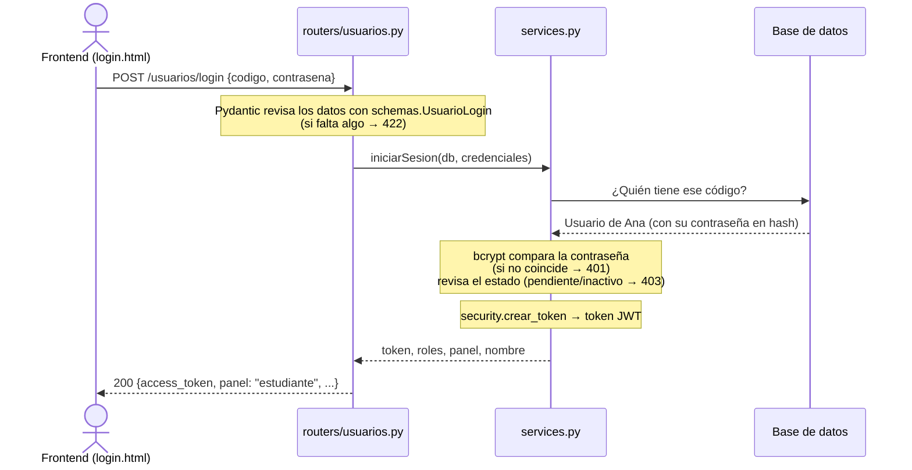

# 02 · El backend explicado desde cero

> Para: compañeros que nunca han visto SEPA. Lectura: ~12 minutos.
> Anterior: [01 · Frontend](01-frontend.md) · Siguiente: [03 · Cómo trabajar en el backend](03-backend-como-trabajar.md)

El backend vive en `proyecto-escolar/backend/`. Este documento explica **qué es** y **cómo funciona**, sin entrar en todos los detalles. Para eso está la documentación técnica en [docs/backend/](../backend/README.md).

---

## 1. ¿Qué es un backend? ¿Y una API?

Piensa en un **restaurante**:

| Restaurante | SEPA |
|-------------|------|
| El **cliente** ve el menú y pide | El **frontend** (las pantallas en el navegador) |
| El **mesero** recibe pedidos con un formato fijo y trae el plato | La **API**: las reglas de cómo se piden las cosas |
| La **cocina** prepara, revisa que haya ingredientes y que el pedido tenga sentido | El **backend**: el programa que valida y decide |
| La **despensa** guarda los ingredientes | La **base de datos** (`sistema_escolar.db`) |

- **Backend:** el programa que corre "detrás", recibe peticiones, aplica las reglas (¿la contraseña es correcta?, ¿el correo ya existe?) y guarda o lee datos.
- **API** (*Application Programming Interface*): el "menú" de peticiones que el backend acepta. Cada platillo del menú es un **endpoint**: un método + una ruta, como `POST /usuarios/login`.
- Los pedidos y las respuestas viajan en **JSON**, un formato de texto como `{"codigo": "123456789"}`.

El cliente nunca entra a la cocina: el frontend nunca toca la base de datos directamente.

---

## 2. Las herramientas, en una o dos frases

| Herramienta | Qué es | Dónde la ves |
|-------------|--------|--------------|
| **Python** | El lenguaje en el que está escrito el backend. | Todos los `.py` |
| **FastAPI** | Librería para crear APIs: con un decorador como `@router.post("/login")` conviertes una función en un endpoint. También genera la página de pruebas `/docs`. | `main.py`, `routers/` |
| **Uvicorn** | El "servidor": el programa que se queda escuchando en `http://127.0.0.1:8000` y le pasa cada petición a FastAPI. | Comando `uvicorn main:app --reload` |
| **Pydantic** | Revisa que los datos que llegan tengan la forma correcta (campos obligatorios, 9 dígitos, formato de correo…). Si no, responde 422 automáticamente. | `schemas.py` |
| **SQLAlchemy** | Permite usar la base de datos con clases de Python en vez de escribir SQL a mano. Una clase = una tabla. | `models.py`, `database.py` |
| **SQLite** | La base de datos: un solo archivo, `sistema_escolar.db`, sin instalar nada aparte. | `database.py` |
| **bcrypt** | Convierte la contraseña en un "hash" (un texto revuelto que no se puede regresar a la original). Nunca guardamos contraseñas tal cual. | `security.py → hashear`, `verificar` |
| **JWT** | El formato del token de sesión: un texto firmado con una clave secreta (`SECRET_KEY`) que dice "soy el usuario 5" y no se puede falsificar. Librería: PyJWT. | `security.py → crear_token` |
| **pytest** | Corre las pruebas automáticas (87 hoy) para revisar que nada se rompió. | `test_*.py` |

Explicación más larga de cada una: [docs/backend/01-tecnologias.md](../backend/01-tecnologias.md).

---

## 3. El recorrido de una petición: el login

Supón que Ana escribe su código `123456789` y su contraseña y presiona **Entrar**.

Paso a paso, con el archivo y la función de cada uno:

1. **Llega la petición** a `routers/usuarios.py → iniciar_sesion`.
2. **Pydantic valida** el JSON con `schemas.py → UsuarioLogin`: que `codigo` y `contrasena` no estén vacíos. El código se pasa a mayúsculas.
3. **El router no piensa: delega** a `services.py → iniciarSesion`.
4. **El servicio busca** el código en las tablas `Estudiante`, `Docente` y `Administrador` (`services.py → _ids_por_codigo`).
5. **bcrypt compara** la contraseña escrita contra el hash guardado (`security.py → verificar`). Si no coincide → **401** "Código o contraseña incorrectos".
6. **Revisa el estado** de la cuenta: `pendiente` o `inactivo` → **403**.
7. **Crea el token** (`security.py → crear_token`), válido 8 horas.
8. **Responde** con el token, los roles, el `panel` y el nombre. El frontend guarda el token y redirige.

En las peticiones siguientes (por ejemplo `GET /usuarios/yo`), el token llega en el encabezado `Authorization` y `security.py → usuario_actual` lo revisa antes de dejar pasar la petición.

Recorrido completo del **registro**, con más detalle: [docs/backend/02-arquitectura.md](../backend/02-arquitectura.md).

---

## 4. Qué archivo hace qué

Todos están en `proyecto-escolar/backend/`.

| Archivo | Qué hace |
|---------|----------|
| `main.py` | Punto de arranque: crea la app, configura **CORS** (qué páginas pueden hablar con el backend), crea las tablas y conecta los routers. |
| `routers/` | Los **endpoints**, agrupados: `usuarios.py`, `catalogos.py`, `cursos.py`, `docentes.py`, `admin.py`. Reciben, delegan y responden. |
| `services.py` | La **lógica de negocio**: todas las reglas ("el correo no se repite", "solo el dueño edita su curso"). |
| `schemas.py` | **Qué forma deben tener** los datos que entran y salen (Pydantic). |
| `models.py` | **Las tablas** de la base de datos (SQLAlchemy). |
| `database.py` | La conexión a `sistema_escolar.db`. |
| `security.py` | Contraseñas (bcrypt), tokens (JWT) y revisión de roles. |
| `config.py` | Valores fijos: dominios de correo por rol, carreras iniciales, días de la semana… |
| `errores.py` | Traduce al español los errores de validación (422). |
| `crear_admin.py` | Script para crear el **primer** administrador desde la terminal. |
| `planes.json` | Planes de estudio de ICOM e INFO (materias por semestre) que se cargan al iniciar. |
| `conftest.py`, `helpers.py`, `test_*.py` | Las pruebas automáticas. |

La regla del equipo es: **router → services → (models / schemas)**. El router nunca tiene reglas de negocio; el servicio nunca sabe de rutas HTTP.

---

## 5. Qué puede hacer cada rol

El rol se decide por el **dominio del correo** al registrarse (`config.py → DOMINIOS_ROL`):

- `@alumnos.udg.mx` → **estudiante** (cuenta activa de inmediato).
- `@academicos.udg.mx` → **docente** (cuenta **pendiente** hasta que un administrador la aprueba).
- El **administrador** no se registra: lo crea `crear_admin.py` u otro administrador.

| Acción | Estudiante | Docente | Administrador | Endpoint |
|--------|:---:|:---:|:---:|----------|
| Registrarse | ✅ | ✅ | — | `POST /usuarios/registro` |
| Iniciar / cerrar sesión, ver su perfil | ✅ | ✅ | ✅ | `/usuarios/login`, `/logout`, `/yo` |
| Ver cursos activos (sin su código de acceso) | ✅ | ✅ | ✅ | `GET /cursos` |
| Inscribirse a un curso con su código | ✅ | — | — | `POST /inscripcion` |
| Crear cursos | — | ✅ | — | `POST /cursos` |
| Ver, editar y archivar **sus** cursos y ver sus alumnos | — | ✅ | — | `/docente/cursos/...` |
| Aprobar o desactivar cuentas | — | — | ✅ | `PATCH /admin/usuarios/{id}/estado` |
| Crear docentes y administradores | — | — | ✅ | `POST /admin/docentes`, `/admin/administradores` |
| Restablecer contraseñas | — | — | ✅ | `PATCH /admin/usuarios/{id}/contrasena` |
| Crear carreras y ciclos escolares | — | — | ✅ | `POST /admin/carreras`, `/admin/ciclos` |
| Ver todos los cursos y reasignar su docente | — | — | ✅ | `/admin/cursos/...` |

Los catálogos (`/catalogos/...`) son **públicos**: no piden sesión, porque el formulario de registro los necesita.

- Si un usuario intenta algo que su rol no permite → **403**.
- Si no tiene sesión o su token venció → **401**.

Cada endpoint con su detalle: [docs/backend/05-endpoints.md](../backend/05-endpoints.md). Cómo se revisan los roles: [docs/backend/04-seguridad.md](../backend/04-seguridad.md#4-cómo-se-verifica-el-rol).

---

[← Anterior: 01 · Frontend](01-frontend.md) · [Siguiente: 03 · Cómo trabajar en el backend →](03-backend-como-trabajar.md)
