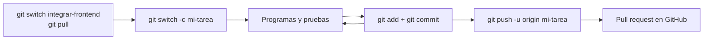

# 03 · Cómo trabajar en el backend (guía práctica)

> Para: compañeros que van a programar en SEPA por primera vez. Lectura: ~15 minutos.
> Anterior: [02 · El backend explicado](02-backend-como-funciona.md) · Siguiente: [04 · La base de datos](04-base-de-datos.md)

Todo está pensado para **Windows** y **PowerShell** (la terminal azul que trae Windows). Sigue los pasos en orden; los comandos van en recuadros y se copian tal cual.

---

## 1. Instalar lo necesario en Windows

Solo se hace **una vez** por computadora.

### 1.1 Python

1. Entra a https://www.python.org/downloads/ y descarga **Python 3.10 o más nuevo**. El código necesita al menos 3.10; el equipo usa 3.14.
2. Al instalar, **marca la casilla "Add python.exe to PATH"** antes de presionar *Install Now*. Si no la marcas, la terminal no encontrará `python`.
3. Abre una PowerShell **nueva** y revisa:

   ```powershell
   python --version
   ```

   Debe decir `Python 3.x.x`. Si se abre la Microsoft Store, Python no quedó en el PATH: reinstala marcando la casilla.

### 1.2 Git

**Git** guarda el historial de cambios del código y permite trabajar en equipo sin pisarse.

1. Descárgalo de https://git-scm.com/download/win e instala con las opciones por defecto.
2. En una PowerShell nueva, dile a Git quién eres (una sola vez):

   ```powershell
   git config --global user.name "Tu Nombre"
   git config --global user.email "tu-correo@ejemplo.com"
   ```

   Usa el mismo correo de tu cuenta de GitHub.

### 1.3 VS Code y sus extensiones

1. Descarga VS Code de https://code.visualstudio.com/ e instálalo.
2. Abre la pestaña **Extensiones** (`Ctrl + Shift + X`) e instala estas cuatro:

| Extensión (búscala por este nombre) | Para qué |
|-------------------------------------|----------|
| **Python** (de Microsoft) | Colores, autocompletado y elegir el venv del proyecto |
| **Live Server** (de Ritwick Dey) | Abrir el frontend en `http://127.0.0.1:5500` |
| **Markdown Preview Mermaid Support** | Ver los diagramas de estos documentos dentro de VS Code |
| **SQLite Viewer** | Ver el contenido de la base de datos (ver [documento 04](04-base-de-datos.md#5-ver-el-contenido-de-la-base)) |

> Tip: en VS Code, **Terminal → New Terminal** (`` Ctrl + ` ``) abre una PowerShell abajo del editor. Ahí puedes correr todos los comandos.

---

## 2. Traer el proyecto a tu computadora

1. Ve a la carpeta donde quieras guardar el proyecto, por ejemplo Documentos:

   ```powershell
   cd $HOME\Documents
   ```

2. **Clona** el repositorio. Clonar es descargar una copia con todo su historial:

   ```powershell
   git clone https://github.com/Huitrado/SEPA.git
   ```

3. Entra a la carpeta:

   ```powershell
   cd SEPA
   ```

4. **Cámbiate de rama.** Una **rama** es una línea de trabajo paralela. Hoy el backend y el frontend completos están en `integrar-frontend` (todavía no se unen a `main`):

   ```powershell
   git switch integrar-frontend
   ```

   > **Por confirmar:** cuando el equipo una estos cambios a `main`, la rama de trabajo será `main` y este paso cambiará.

5. Abre el proyecto en VS Code:

   ```powershell
   code .
   ```

---

## 3. Arrancar el backend paso a paso

Todos los comandos de aquí en adelante se ejecutan **dentro de la carpeta `backend`**, porque los archivos se importan entre sí por nombre (`import models`).

```powershell
cd proyecto-escolar\backend
```

### Paso 1. Crear el entorno virtual (una sola vez)

Un **entorno virtual (venv)** es una carpeta con un Python aislado solo para este proyecto, para que sus librerías no choquen con las de otros proyectos.

```powershell
python -m venv venv
```

Se crea `backend\venv\`. Git la ignora (no se sube).

### Paso 2. Activar el venv (cada vez que abras una terminal)

```powershell
.\venv\Scripts\Activate.ps1
```

Funcionó si la línea de la terminal empieza con **`(venv)`**.

> Si sale "la ejecución de scripts está deshabilitada en este sistema", ejecuta esto y vuelve a activar (solo afecta a esa ventana):
> ```powershell
> Set-ExecutionPolicy -Scope Process -ExecutionPolicy Bypass
> ```

### Paso 3. Instalar las dependencias (una sola vez)

Las **dependencias** son librerías de otras personas que nuestro código usa (FastAPI, bcrypt…). `pip` es el instalador de Python.

```powershell
pip install -r requirements.txt
pip install pytest httpx
```

- La primera línea instala lo que dice `requirements.txt`: fastapi, uvicorn, sqlalchemy, email-validator, bcrypt y PyJWT.
- La segunda instala lo que necesitan las pruebas.

> **Por confirmar:** `pytest` y `httpx` no están en `requirements.txt`. Por eso van aparte. Falta decidir en equipo si se agregan.

### Paso 4. Definir `SECRET_KEY` (cada vez que abras una terminal)

`SECRET_KEY` es la clave con la que el backend **firma** los tokens de sesión. Es una **variable de entorno**: un valor que se guarda en la terminal, no en el código, para que no termine en GitHub.

Genera una clave aleatoria:

```powershell
python -c "import secrets; print(secrets.token_hex(32))"
```

Copia el resultado y pégalo aquí:

```powershell
$env:SECRET_KEY = "pega-aqui-la-clave"
```

- Si te saltas este paso, el backend usa `"clave-de-desarrollo-solo-local"` (ver `security.py`). Sirve para practicar en tu computadora, **nunca** para un servidor real.
- Dura mientras la terminal esté abierta.
- Si la cambias, todos tienen que volver a iniciar sesión.

> **Por confirmar:** el código no lee archivos `.env`; la variable se define en la terminal cada vez.

### Paso 5. Crear el primer administrador (una sola vez)

```powershell
python crear_admin.py
```

Te pregunta nombre, apellidos, correo, número de empleado y contraseña. La contraseña **no se ve** mientras escribes; debe tener 8 o más caracteres, una mayúscula, una minúscula y un número.

- El **número de empleado** será tu código para iniciar sesión (se guarda en mayúsculas).
- Este script también crea el archivo de base de datos `sistema_escolar.db` si no existe.

### Paso 6. Encender el servidor

```powershell
uvicorn main:app --reload
```

- `main:app` = "en el archivo `main.py`, usa la variable `app`".
- `--reload` = reinicia solo cada vez que guardas un `.py`.

Verás `Uvicorn running on http://127.0.0.1:8000`. **Deja esa terminal abierta**; para apagar el servidor presiona `Ctrl + C`.

### Paso 7. Abrir `/docs`

En el navegador entra a **http://127.0.0.1:8000/docs**. Es una página que FastAPI genera sola, con todos los endpoints y botones para probarlos (sección 4).

### Paso 8. Correr las pruebas automáticas

En **otra** terminal (con el venv activado y dentro de `backend`):

```powershell
pytest -v
```

`-v` muestra el nombre de cada prueba. Hoy deben salir **87 passed** (tarda alrededor de un minuto). Las pruebas usan una base de datos temporal en memoria: **no tocan** tu `sistema_escolar.db`.

### Resumen para las siguientes veces

```powershell
cd proyecto-escolar\backend
.\venv\Scripts\Activate.ps1
$env:SECRET_KEY = "tu-clave"
uvicorn main:app --reload
```

Para ver el frontend, abre `proyecto-escolar/frontend/login.html` con Live Server (ver [documento 01](01-frontend.md#4-cómo-abrirlo-live-server-en-el-puerto-5500)).

---

## 4. Probar un endpoint en `/docs`

### Un endpoint público (no pide sesión)

1. En http://127.0.0.1:8000/docs busca **GET /catalogos/carreras** y haz clic para abrirlo.
2. Clic en **Try it out** → **Execute**.
3. Abajo verás el **código de respuesta** (`200`) y el JSON con las carreras.

### Un endpoint protegido (con el botón Authorize)

1. Abre **POST /usuarios/login** → **Try it out**.
2. En el cuadro de texto escribe tu código y contraseña:

   ```json
   { "codigo": "A-001", "contrasena": "TuContrasena1" }
   ```

3. **Execute**. En la respuesta, copia el valor de `access_token` (el texto largo, **sin** las comillas).
4. Sube al principio de la página y haz clic en el botón **Authorize** (tiene un candado).
5. Pega el token en el campo **Value** → **Authorize** → **Close**.
6. Ahora prueba **GET /usuarios/yo** → **Try it out** → **Execute**. Debe responder `200` con tu perfil.

Si responde **401**, el token está mal copiado, venció (8 horas) o cerraste sesión: repite desde el paso 1. Si responde **403**, tu rol no puede usar ese endpoint.

---

## 5. Cómo agregar un endpoint nuevo (nuestro patrón)

El equipo sigue siempre el mismo orden: **router → services → schemas**, y cada endpoint lleva su prueba.

| Capa | Archivo | Responsabilidad |
|------|---------|-----------------|
| Router | `routers/*.py` | Recibir la petición y devolver la respuesta. Nada de reglas. |
| Servicio | `services.py` | Las reglas y las consultas a la base. Lanza `HTTPException` si algo falla. |
| Esquema | `schemas.py` | La forma de los datos que entran y salen. |
| Prueba | `test_*.py` | Comprobar que funciona y que falla cuando debe. |

### Ejemplo para practicar: buscar una carrera por su clave

> **Este endpoint NO existe en el proyecto.** Es solo un ejemplo para practicar en tu propia rama.

Queremos `GET /catalogos/carreras/{clave}`: por ejemplo, `/catalogos/carreras/info` responde con la carrera INFO, o con **404** si no existe.

**1. Esquema (`schemas.py`).** Para la respuesta ya existe `CarreraSalida` (con `id`, `clave` y `nombre`), así que **no hay que crear nada**. Solo crearías un esquema nuevo si el endpoint recibiera un JSON (como `CarreraCrear` en `POST /admin/carreras`) o devolviera una forma distinta.

**2. Servicio (`services.py`).** Agrega esta función, por ejemplo debajo de `crear_carrera`:

```python
def buscar_carrera(db: Session, clave: str) -> models.Carrera:
    carrera = db.query(models.Carrera).filter_by(clave=clave.upper()).first()
    if not carrera:
        raise HTTPException(404, "Carrera no encontrada")
    return carrera
```

- `filter_by(clave=...)` busca la fila con esa clave.
- `.upper()` hace que `info` e `INFO` funcionen igual, porque las claves se guardan en mayúsculas.
- `HTTPException(404, ...)` hace que FastAPI responda `{"detail": "Carrera no encontrada"}` con código 404.

**3. Router (`routers/catalogos.py`).** Agrega, debajo del endpoint `carreras`:

```python
@router.get("/carreras/{clave}", response_model=schemas.CarreraSalida)
def carrera_por_clave(clave: str, db: Session = Depends(get_db)):
    return services.buscar_carrera(db, clave)
```

- `{clave}` en la ruta llega como el parámetro `clave`.
- `response_model` dice qué campos se devuelven.
- `Depends(get_db)` le da a la función una conexión a la base.
- No pide sesión, igual que los demás catálogos. Para pedirla, agregarías `_: models.Usuario = Depends(usuario_actual)`, como en `routers/cursos.py → obtener_cursos`.

**4. Prueba (archivo nuevo `test_catalogos.py` en `backend/`):**

```python
def test_buscar_carrera_por_clave(client):
    r = client.get("/catalogos/carreras/info")
    assert r.status_code == 200
    assert r.json()["nombre"] == "Ingeniería Informática"

def test_buscar_carrera_inexistente(client):
    r = client.get("/catalogos/carreras/XXXX")
    assert r.status_code == 404
    assert r.json()["detail"] == "Carrera no encontrada"
```

- `client` es una **fixture**: una preparación que pytest te da lista. Está en `conftest.py`, crea una base vacía en memoria y le agrega la carrera INFO (`helpers.py → sembrar_base`).
- `assert` significa "esto debe ser verdad"; si no lo es, la prueba falla.

**5. Comprueba:**

```powershell
pytest test_catalogos.py -v
```

y en `/docs` debe aparecer el endpoint nuevo.

Más recetas de pruebas: [docs/backend/07-pruebas.md](../backend/07-pruebas.md).

---

## 6. Flujo de Git del equipo

Regla de oro: **nunca trabajes directo en `main`**. Cada tarea va en su propia rama.



| Paso | Comando | Qué hace |
|------|---------|----------|
| 1 | `git switch integrar-frontend` | Te pasa a la rama base (hoy `integrar-frontend`; **por confirmar** si después será `main`). |
| 2 | `git pull` | Descarga los cambios más recientes que subieron tus compañeros. |
| 3 | `git switch -c agrega-busqueda-carrera` | Crea una rama nueva con ese nombre y te cambia a ella. Usa nombres cortos que digan qué haces. |
| 4 | `git status` | Muestra qué archivos cambiaste. Úsalo seguido. |
| 5 | `git add proyecto-escolar/backend/services.py` | Marca ese archivo para el próximo commit. `git add .` marca todo lo que cambió (revisa antes con `git status`). |
| 6 | `git commit -m "Agrega búsqueda de carrera por clave"` | Guarda una "foto" de los cambios marcados, con un mensaje que explica qué hiciste. |
| 7 | `git push -u origin agrega-busqueda-carrera` | Sube tu rama a GitHub. El `-u` solo hace falta la primera vez; después basta `git push`. |
| 8 | (en GitHub) | Abre un **pull request**: una solicitud para que el equipo revise tu rama antes de unirla. |

Antes de hacer `commit`, corre `pytest` para no subir algo roto. **Nunca** subas `venv\`, `sistema_escolar.db` ni claves: el `.gitignore` ya los excluye.

---

## 7. Problemas comunes

| Síntoma | Causa probable | Solución |
|---------|----------------|----------|
| `python` abre la Microsoft Store o "no se reconoce" | Python no está en el PATH | Reinstala Python marcando "Add python.exe to PATH" y abre una terminal nueva |
| "la ejecución de scripts está deshabilitada" al activar el venv | Política de PowerShell | `Set-ExecutionPolicy -Scope Process -ExecutionPolicy Bypass` y activa otra vez |
| `ModuleNotFoundError: No module named 'fastapi'` | El venv no está activado o no instalaste dependencias | Activa el venv (debe verse `(venv)`) y corre `pip install -r requirements.txt` |
| `ModuleNotFoundError: No module named 'models'` | Estás en otra carpeta | `cd proyecto-escolar\backend` |
| `pytest` no se reconoce, o un error que menciona `httpx` | Faltan las librerías de pruebas | `pip install pytest httpx` |
| Uvicorn dice que el puerto 8000 está en uso | Ya hay otro uvicorn abierto | Ciérralo con `Ctrl + C` en su terminal (o cierra esa terminal) |
| En el navegador (F12 → Consola) sale un error de **CORS** | El frontend no está en el puerto 5500 | Ábrelo con Live Server y revisa que la dirección diga `:5500` ([doc 01](01-frontend.md#4-cómo-abrirlo-live-server-en-el-puerto-5500)) |
| El frontend dice "No se pudo conectar con el servidor" | El backend está apagado | Arráncalo (sección 3, paso 6) |
| El login funcionaba y ahora da **401** | El token venció (8 h), cerraste sesión o cambió `SECRET_KEY` | Inicia sesión de nuevo |
| Un docente no puede entrar: **403** "pendiente de aprobación" | Así funciona: un admin debe aprobarlo | Con un token de admin, en `/docs`: `PATCH /admin/usuarios/{id}/estado` con `{"estado": "activo"}` |
| Errores raros de "no such column" después de un `git pull` | Alguien cambió `models.py` y tu base es vieja | Borra `sistema_escolar.db` y vuelve a crear el admin ([doc 04](04-base-de-datos.md#4-borrar-la-base-para-empezar-de-cero)) |
| `crear_admin.py` dice "El número de empleado ya está registrado" | Ya creaste ese admin antes | Inicia sesión con ese código, o usa otro número |

Más problemas y detalle: [docs/backend/README.md](../backend/README.md#problemas-comunes).

---

[← Anterior: 02 · El backend explicado](02-backend-como-funciona.md) · [Siguiente: 04 · La base de datos →](04-base-de-datos.md)
