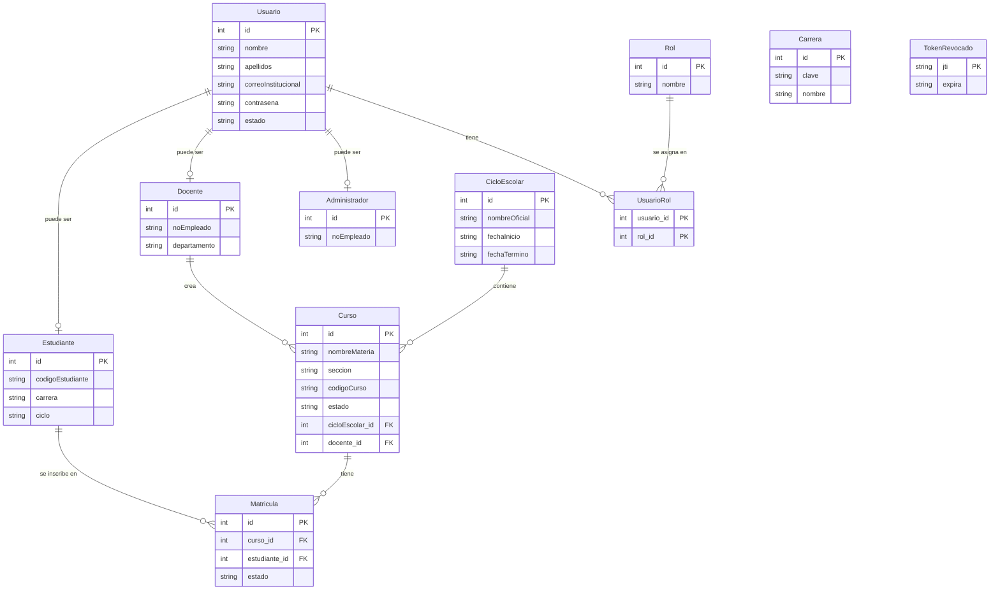

# 04 · La base de datos explicada desde cero

> Para: compañeros que nunca han visto SEPA. Lectura: ~10 minutos.
> Anterior: [03 · Cómo trabajar en el backend](03-backend-como-trabajar.md)

---

## 1. Conceptos básicos con nuestras propias tablas

### Base de datos

Un programa que **guarda información de forma ordenada** y permite buscarla rápido. Nosotros usamos **SQLite**: toda la base es **un solo archivo**, `proyecto-escolar/backend/sistema_escolar.db`. No hay que instalar nada aparte.

### Tabla

Una tabla es como una **hoja de Excel**: cada **columna** es un dato (nombre, correo…) y cada **fila** es un registro (una persona). Así se ve la tabla `Usuario`:

| id | nombre | apellidos | correoInstitucional | estado |
|----|--------|-----------|---------------------|--------|
| 1 | Root | Admin | admin@escuela.mx | activo |
| 2 | Ana | López | ana@alumnos.udg.mx | activo |
| 3 | Luis | Pérez | luis@academicos.udg.mx | pendiente |

(Tiene además `contrasena`, guardada como hash de bcrypt, y `fechaRegistro`.)

En el código, cada tabla es una **clase** en `models.py`. Por ejemplo, `models.py → Usuario`.

### Llave primaria (PK, *primary key*)

La columna que **identifica a cada fila sin repetirse**, como la CURP de una persona. En casi todas nuestras tablas es `id`, un número que la base asigna sola (1, 2, 3…).

### Llave foránea (FK, *foreign key*)

Una columna que **apunta a la llave primaria de otra tabla**. Sirve para relacionar tablas. Ejemplo real:

**Tabla `Estudiante`** (solo los datos que son exclusivos de un estudiante):

| id (PK y FK → Usuario.id) | codigoEstudiante | carrera | ciclo |
|---------------------------|------------------|---------|-------|
| 2 | 123456789 | INFO | 2026-B |

El `id = 2` de `Estudiante` **es el mismo** `id = 2` de `Usuario`: es Ana. Los datos comunes (nombre, correo, contraseña) están en `Usuario` y los de estudiante, aquí. Lo mismo pasa con `Docente` y `Administrador`.

Otro ejemplo: en **`Matricula`** (la inscripción de un alumno a un curso) hay dos llaves foráneas:

- `curso_id` → `Curso.id`
- `estudiante_id` → `Estudiante.id`

Así, la fila `{curso_id: 1, estudiante_id: 2}` significa "Ana está inscrita en el curso 1".

> SQLite ignora las llaves foráneas si no se le pide revisarlas. Nosotros las activamos en `database.py → activar_llaves_foraneas`.

---

## 2. Las tablas que se usan hoy



En el diagrama solo aparecen las columnas principales. Cómo leer las líneas: `||--o{` = "uno a muchos" (un curso tiene muchas matrículas); `||--o|` = "uno a uno o ninguno" (un usuario puede tener o no un perfil de estudiante).

| Tabla | Para qué sirve |
|-------|----------------|
| `Usuario` | Datos comunes de **todas** las personas, incluido su `estado`: `activo`, `pendiente` o `inactivo`. |
| `Estudiante`, `Docente`, `Administrador` | El "perfil" de cada tipo de usuario. Su `id` es el mismo que en `Usuario`. |
| `Rol`, `UsuarioRol` | Qué rol(es) tiene cada usuario. `UsuarioRol` une usuarios con roles. |
| `Carrera` | Catálogo de carreras (ICOM, INFO…). |
| `CicloEscolar` | Ciclos como `2026-B`, con fecha de inicio y de fin. |
| `Curso` | Cursos que crea un docente, con su código de acceso (`codigoCurso`). |
| `Matricula` | Qué estudiante está inscrito en qué curso. |
| `TokenRevocado` | Sesiones cerradas con logout, para que ese token ya no sirva. |

Detalles a saber:

- **`Estudiante.carrera` guarda la clave como texto** (`"INFO"`), no un `id` de `Carrera`. No hay llave foránea entre ellas: el backend revisa que la clave exista al registrar (`services.py → _validar_catalogos`). Por eso en el diagrama no hay línea entre `Carrera` y `Estudiante`.
- **`MallaCurricular`, `Materia` y `MallaMateria`** guardan los planes de estudio de ICOM e INFO. Se llenan al arrancar (sección 3), pero **hoy ningún endpoint las consulta**.
- **El resto de las tablas de `models.py` existen para módulos futuros:** asistencia, calificaciones, actividades, riesgo académico, asesorías, etc. Hoy nadie las usa. Son 10: `HistorialAcademico`, `PublicacionAsesoria`, `BibliotecaNormatividad`, `SesionClase`, `Asistencia`, `RegistroRiesgo`, `CategoriaEvaluacion`, `Actividad`, `Entrega` y `Calificacion`.
- **Por confirmar:** `Curso.materia_id` y `Estudiante.mallaCurricular_id` existen como columnas, pero el código actual nunca las llena.

Detalle de cada tabla y columna, con el diagrama completo: [docs/backend/03-base-de-datos.md](../backend/03-base-de-datos.md).

---

## 3. Cómo se crea la base y qué datos trae

**No hay que crearla a mano.** No hay archivos SQL: SQLAlchemy la arma a partir de las clases de `models.py`.

1. Cuando arranca `uvicorn` (o corres `python crear_admin.py`), se ejecuta `models.Base.metadata.create_all(...)` (en `main.py` y en `crear_admin.py → main`).
2. Si `sistema_escolar.db` **no existe**, se crea con todas las tablas. Si ya existe, solo agrega las tablas que falten.
3. Después, `services.py → sembrar_catalogos` mete los **datos iniciales**, pero solo en las tablas que estén vacías:

| Qué inserta | De dónde sale |
|-------------|---------------|
| Carreras **ICOM** (Ingeniería en Computación) e **INFO** (Ingeniería Informática) | `config.py → CARRERAS_INICIALES` |
| Planes de estudio de ICOM e INFO, con sus materias por semestre | `planes.json` |
| El **ciclo escolar de hoy**, por ejemplo `2026-B` del 16/07/2026 al 16/12/2026 | `services.py → ciclo_para_fecha` |

**No se crean usuarios.** El primer administrador lo creas tú con `python crear_admin.py` ([documento 03](03-backend-como-trabajar.md#paso-5-crear-el-primer-administrador-una-sola-vez)).

El archivo `.db` **no se sube a GitHub** (está en `.gitignore`). Cada quien tiene su propia base con sus propios datos de prueba.

---

## 4. Borrar la base para empezar de cero

Hazlo si tus datos de prueba se hicieron un desastre, o si alguien cambió `models.py` y ves errores como "no such column".

1. Apaga el servidor: `Ctrl + C` en la terminal de uvicorn.
2. Borra el archivo (desde la carpeta `backend`):

   ```powershell
   Remove-Item sistema_escolar.db
   ```

   También puedes borrarlo desde el explorador de VS Code. Si dice que el archivo está en uso, cierra el visor de SQLite o DB Browser que lo tenga abierto.
3. Vuelve a crear el administrador:

   ```powershell
   python crear_admin.py
   ```

4. Enciende otra vez el servidor: `uvicorn main:app --reload`.

> ⚠️ **Se pierden todos los datos** de esa base (usuarios, cursos, inscripciones).

¿Por qué hay que borrarla cuando cambia `models.py`? Porque `create_all` **no agrega columnas nuevas** a tablas que ya existen. El proyecto no usa una herramienta de **migraciones** (programas que actualizan la estructura de una base sin borrarla, como Alembic).

---

## 5. Ver el contenido de la base

### Opción A: SQLite Viewer en VS Code (la más fácil)

1. Instala la extensión **SQLite Viewer** (ver [documento 03](03-backend-como-trabajar.md#13-vs-code-y-sus-extensiones)).
2. En el explorador de VS Code, haz clic en `proyecto-escolar/backend/sistema_escolar.db`.
3. Se abre una vista con la lista de tablas a la izquierda. Elige una, por ejemplo `Usuario`, para ver sus filas.

Es **solo para ver**. Si quieres que el visor muestre datos nuevos, ciérralo y ábrelo otra vez.

### Opción B: DB Browser for SQLite

1. Descárgalo de https://sqlitebrowser.org/ e instálalo.
2. **Abrir base de datos** → elige `sistema_escolar.db`.
3. Pestaña **Hojear datos** para ver las filas. En **Ejecutar SQL** puedes escribir consultas, por ejemplo:

   ```sql
   SELECT nombre, apellidos, estado FROM Usuario;
   ```

> ⚠️ **No modifiques datos a mano** mientras el servidor está encendido, y si lo haces, presiona **Escribir cambios** y cierra el programa. Una base abierta y bloqueada puede hacer fallar al backend. Lo más seguro es cambiar datos a través de la API (`/docs`).

Las contraseñas se ven como `$2b$12$...`: es el hash de bcrypt, no la contraseña real (ver [docs/backend/04-seguridad.md](../backend/04-seguridad.md#1-cómo-se-guardan-las-contraseñas-bcrypt)).

---

[← Anterior: 03 · Cómo trabajar en el backend](03-backend-como-trabajar.md) · [Volver al inicio: 01 · Frontend](01-frontend.md)
